# HELPTOA Bot — desenho do fluxo atual

> Retrato do codigo em 22/09/2026. Cobre **atendimento**, **menu**, **roteamento por caso**, **formulario de validacao**, **timers**, **banco** e **painel**.
> Diagramas em Mermaid — renderizam no VS Code, GitHub e na maioria dos visualizadores de Markdown.

## 1. Visao de contexto

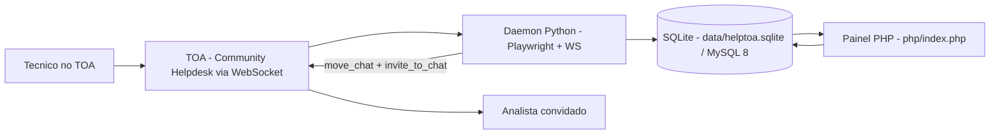

- O bot **nao usa API HTTP** para operar: fala com o TOA pelo WebSocket nativo da sessao, aberto pela propria pagina, e reaproveita a sessao do Chromium em `.chrome-profile/`.
- O banco guarda **so** `chat_id`, status, classificacao, retries e timestamps — nenhum texto de conversa.

## 2. Componentes

| Arquivo | Papel |
|---|---|
| `run.py` | entrada do daemon |
| `python/main.py` | ciclo de vida: lock, navegador, `run_once`, timers de 5 s, reciclagem do Chromium |
| `python/auth.py` | login/SSO no TOA, escolha da pagina ativa |
| `python/toa.py` | `ToaSocket`: envia comandos `a/d/r`, recebe notes, guarda `own_address` |
| `python/engine.py` | **cerebro**: assumir chat, abertura form-aware, menu, scripts, classificacao, transferencia, formulario, roteamento |
| `python/routing.py` | motor puro de decisao: heranca de ajustes, filtros, estrategia e detalhe de diagnostico |
| `python/form_open.py` | deteccao do formulario, **identidade do solicitante** e **correlacao com o chat do tecnico** |
| `python/db.py` | acesso, migracoes, **ledger de casos**, jobs (backend decidido por `config.db_backend()`) |
| `python/sqlcompat.py` | tradutor SQLite → MySQL no *choke point* + fachada de conexao (so age no backend `mysql`) |
| `python/resource_profile.py` | valida perfil de gestor do operador nos scripts |
| `python/scripts/` | scripts de atendimento (`criar_apoio`, `criar_infra_rede`, `remanejamento_rota`, `criar_acesso_hub`) + `registry.py` + `manifest.json` + `bases/` |
| `schema.sql` | DDL aplicada tanto pelo Python quanto pelo PHP |
| `php/index.php` + `php/bootstrap.php` | painel: abas, acoes POST, render e migracoes |
| `tests/` | 487 testes Python (24 arquivos, rodam offline em SQLite) + 10 suites PHP |

## 3. Entrada de um chat: assumir ou ignorar

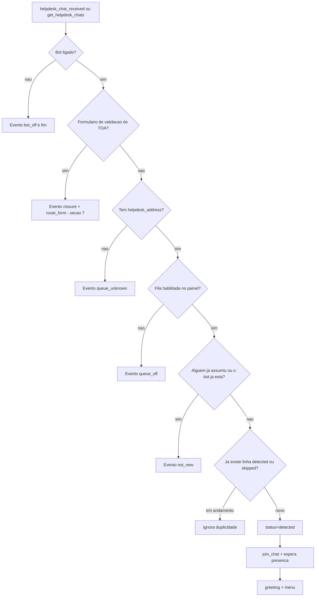

**Registro de cada passo:** `bot_events` (ver secao 13) e `chats` (ver secao 14).
Se o tecnico que abriu o chat de fila **ja tem formulario de validacao aberto**, a
assuncao cai na **abertura form-aware** (secao 4.1) em vez do menu.


## 4. Menu, submenu, digito, retries e timeout

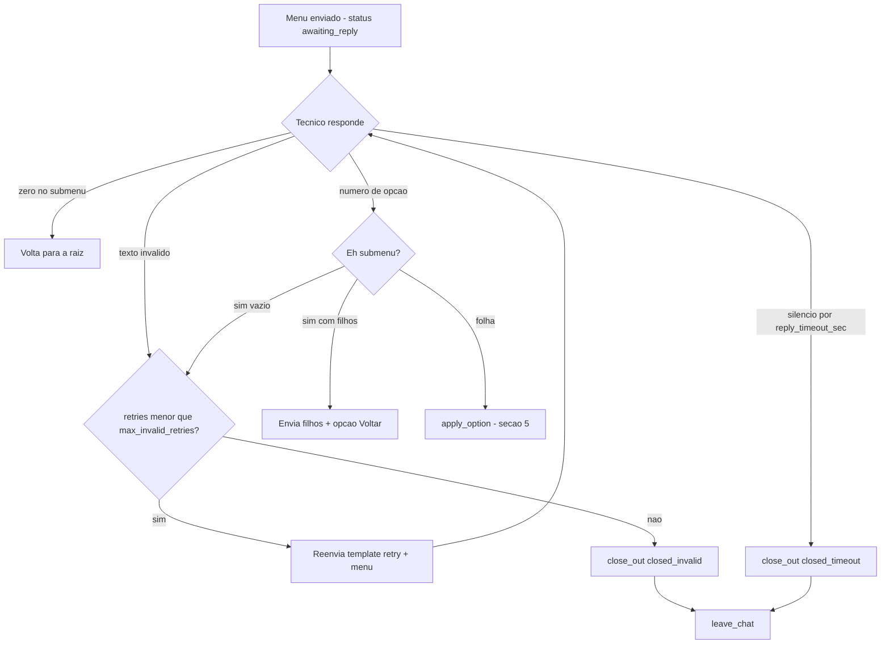

- Raiz = `greeting` + `menu` + opcoes. Submenu = titulo + filhos + `0) Voltar`.
- A opcao e escolhida pelo `sort_order` igual ao digito.
- O timeout vale tambem dentro do submenu, porque reusa o mesmo `last_prompt_at`.
- O estado (`awaiting_reply` + `last_prompt_at`) e gravado **antes** do `send_message`: a resposta que
  chega enquanto o ACK do envio esta em curso (ate 8 s quando o TOA nao devolve eco) nao se perde.
- O cronometro mede **silencio do tecnico**: qualquer mensagem do solicitante atualiza `last_reply_at`
  e reinicia a contagem (resposta invalida tambem conta). `closed_timeout` so acontece com silencio real.
- Ao voltar de restart/reciclagem, `replay_pending_reply` le as ultimas mensagens do chat no TOA e
  processa a resposta que chegou com o bot fora (evento `reply_replayed`), antes de qualquer timeout.
- Retries sao contados em `chats.retries`; template `retry` e configuravel na aba Templates.

### Abertura form-aware (chat com formulário aberto) — **REMOVIDA em 28/09/2026**

O bot **não** verifica mais se o técnico tem formulário de validação em andamento: assumiu o
chat da fila, ele **sempre** recebe o menu da fila (`greeting` + `menu`).

Motivo: a correlação acertava pouco (`form_aware_skip` na maioria) e, quando errada, misturava
formulário de outro técnico no caso. Saíram junto: o status `awaiting_form_choice`, os textos
`form_pending`, `form_pending_wait` e `form_waiting` (apagados da tabela `templates` pela
migração), os eventos `form_aware_greeting`, `form_aware_choice`, `form_aware_wait`,
`form_aware_skip` e `case_linked`, e a rota presa ao dono (`pending_routes.expects_owner`, que
fica só como coluna legada).

**O que continua:** o formulário de validação segue roteado para o time da fila (fila habilitada
+ time ativo + `team_routing.form_enabled`), com afinidade pelo caso (`case_key`), peça irmã
(`case_sibling_delivered`) e fechamento por ausência no TOA / ociosidade. A coluna
`chats.linked_form_chat_id` também fica (legado, sem uso).
## 5. Folha escolhida: onde a demanda e decidida

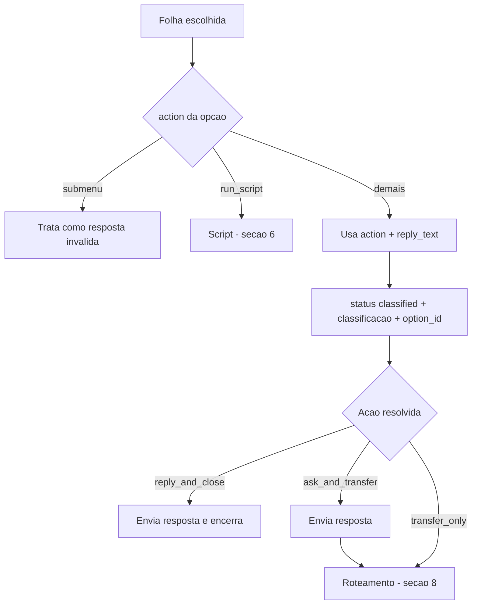

| `action` | O que faz |
|---|---|
| `reply_and_close` | envia `reply_text` e encerra com `leave_chat` — status `closed` |
| `ask_and_transfer` | envia `reply_text` e **tenta transferir**; com perguntas cadastradas na opcao, **coleta antes** (secao 6.1) |
| `transfer_only` | **tenta transferir** sem texto |
| `submenu` | abre os filhos — nao e folha |
| `run_script` | inicia o script configurado na opcao |


## 6. Scripts `run_script`

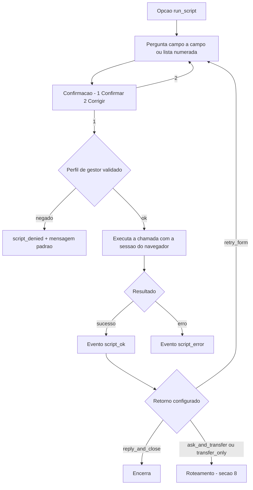

- Status durante o script: `awaiting_script_answer` -> `awaiting_script_confirm` -> `awaiting_script_run`.
- Os campos aceitam `text`, `int` e `choice` (escolha pelo numero da lista).
- **Campos dinamicos:** quando o script define `fields_for(answers)`, a lista de perguntas e
  recalculada a cada resposta — e assim que `criar_acesso_hub` pergunta o hub, o numero de tecnicos
  e so entao os blocos 1..N + motivo. Sem o hook vale o `FIELDS` estatico, como em `criar_apoio`
  e `criar_infra_rede` (o manifest continua sendo o espelho estatico do `FIELDS`).
- **Validacao propria do script:** `normalize_answer(key, text, answers)` devolve
  `{value, state, retry, message}`. `retry=false` re-pergunta **sem** gastar tentativa (e o caso das
  sugestoes de hub), `message` e enviado antes da pergunta e `state` (chaves internas `_`) e gravado
  **inclusive na recusa** — e assim que a lista de sugestoes chega na proxima pergunta. Sem o hook
  o engine usa a validacao padrao (`text`/`int`/`choice`).
- **`CONFIRM_NOTE`:** texto do script colocado no resumo da confirmacao, antes do
  `1) Confirmar / 2) Corrigir` (ex.: `criar_acesso_hub` avisa que inconsistencia pode gerar recusa).
- `tick_timeouts` retoma script que ficou preso em `awaiting_script_run` (orcamento `BUDGET_SEC`).
- O perfil do operador e checado em `resourcemanagement` (`resource_profile.py`); sem permissao, o bot responde a mensagem padrao e registra o motivo.

### 6.1 Perguntas antes de transferir (`ask_and_transfer` com perguntas)

A folha `ask_and_transfer` pode ter perguntas cadastradas no painel (aba Menus, 1 a 20 por opcao,
tabela `menu_option_questions`). **Sem perguntas o comportamento e o antigo.**

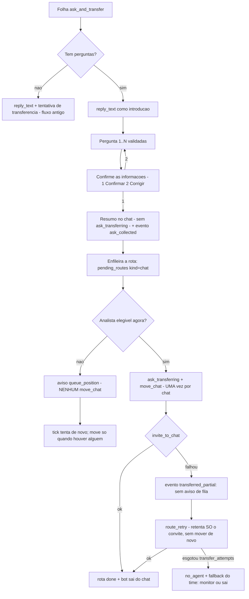

- Tipos de pergunta: `texto`, `numero` e `escolha` (numerada) - a **mesma validacao** dos scripts.
- Estado no banco: `chats.ask_option_id` marca a coleta e `script_field_index`/`script_answers`
  guardam o progresso e as respostas (JSON `q1..qN`). Nada fica em memoria.
- **Ordem das mensagens:** o resumo (`ask_received`) sai sem `ask_transferring`. Com analista elegivel
  o bot manda `ask_transferring` e entrega; sem analista, quem fala e o aviso `queue_position` - assim
  o tecnico nunca ve "estou transferindo/transferido" seguido de "voce e o Nº 1 da fila".
- **`move_chat` uma vez por chat:** a marca fica em `chats.moved_at` (por isso o chat nao e arrastado
  a cada retentativa). Se o `invite_to_chat` for recusado depois do move, a rota registra
  `transferred_partial` e as tentativas seguintes apenas convidam.
- **Restart/kill:** no boot o bot procura primeiro a resposta pendente (`replay_pending_reply`, evento
  `reply_replayed`); sem resposta nova, o `_resume_ask` reenvia a pergunta (ou a confirmacao) atual
  enquanto ela estiver dentro do `reply_timeout_sec`; passado o prazo de silencio, o timeout fecha o
  chat em `closed_timeout`.
- A transferencia passa pela fila (`pending_routes`), entao **sobrevive ao kill**; com a fila ligada ela
  espera por um analista elegivel sem limite de tempo, e com a fila desligada respeita
  `transfer_attempts`/`transfer_retry_interval_sec`; ao esgotar, aplica o fallback do time. A espera sem
  limite vale para "**sem analista**": se o chat **ja foi movido** e o convite esta falhando, as
  tentativas contam normalmente (senao o chat ficaria pulando para sempre).
- Textos configuraveis na aba Templates: `ask_received` (cabecalho do resumo) e `ask_transferring`
  (enviado apenas quando ha entrega).
- Eventos novos: `ask_collected` (respostas no `detail`), `route_retry` (nova tentativa da rota de chat)
  e `transferred_partial` (move feito, convite recusado pelo TOA).
- No painel as respostas aparecem na aba **Chats** (coluna "Respostas", com o texto das perguntas).


## 7. Formulario de validacao: deteccao e roteamento

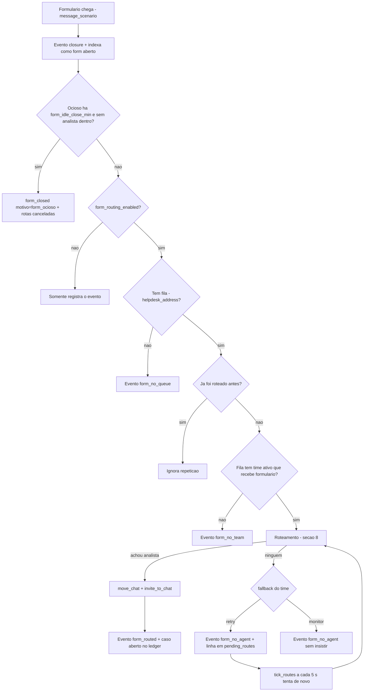

- O bot **nao entra** no formulario, **nao envia mensagem** e **nao encerra**: ele nao e interativo.
  Quem conversa com o tecnico e o **chat dele** (abertura form-aware, secao 4.1) — nunca o formulario.
- Intervalo e limite das novas tentativas: `form_route_retry_interval_sec` e `form_route_attempts`.
- **Leitura viva antes de cada entrega:** o bot le as mensagens do formulario (`get_chat_messages`, so leitura) antes de tentar `move_chat`. Com isso ele (a) **nunca** entrega formulario ja encerrado (`form_skip_past`) e (b) descobre o **AUTOR** das mensagens, que e a identidade do caso quando o payload vem sem o address do tecnico.
- **Ja com analista:** se as mensagens mostram um analista do time dentro (`user_joined`), o bot **adota** esse dono (`form_adopted`) em vez de mover de novo — o TOA recusaria o `move_chat` (`e=10`). No teto de recusas (`form_move_max_fail`) a rota para com `form_move_refused`.
- Uma fila **desabilitada para chat** continua roteando formulario: o que vale e `form_routing_enabled` (global) e **Formulario = recebe** (por time).
- **Janela de vida:** a varredura revalida um formulario por tick e, sem mensagem nova por `form_idle_offer_min` (30 min) e sem analista do time dentro, ele **para de ser oferecido** (`form_aware_skip … ociosos=`); no fechamento valem duas reguas — `form_idle_close_min` (120 min, `motivo=form_ocioso`) e `form_idle_owner_close_min` (240 min, `motivo=form_ocioso_analista`) quando **ha analista do time dentro** (o TOA nao mostra a saida dele). Sem isso um formulario morto ocupava a fila e a vaga do analista ate o TTL de 12 h.
- **Indice enxuto:** a poda roda tambem na varredura e descarta o formulario cujo caso no ledger ja foi encerrado de verdade (`form_done`/`chat_removed` → `form_forget motivo=caso_encerrado`). Caso expirado por TTL/`stale_boot` nao descarta (pode estar aberto no TOA).
- **Palpite so sem responsavel:** candidato com caso aberto no ledger (ou com analista do time dentro) nao entra no palpite por fila; se nao houver nenhum livre, a abertura nao acontece (`em_atendimento:<n>`).
- O mesmo formulario nunca e roteado duas vezes: a marca fica em `pending_routes`, inclusive apos restart. Quando o formulario encerra, as rotas `waiting` dele sao encerradas (`form_route_cancelled`) — antes ficavam tentando `move_chat` para sempre.

## 8. Roteamento: quem recebe a demanda

O roteamento e **um so** para chat e formulario, com a mesma fonte de carga. A unidade de carga e o **CASO**, e um caso e **um solicitante distinto**: formulario + chat do **mesmo tecnico** contam como **um caso**.

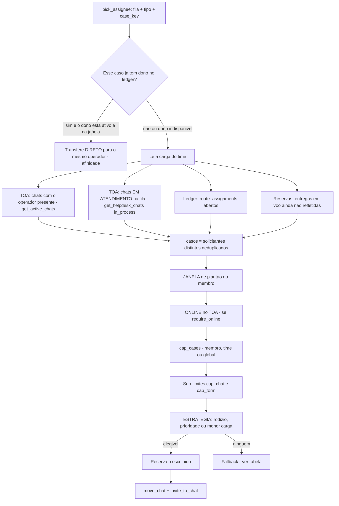

### 8.1 De onde vem a carga

| Fonte | Detalhe | Ajuste |
|---|---|---|
| Chats do operador no TOA | `get_active_chats` - participante com `present` | `route_capacity_source` = active |
| Chats em atendimento na fila | `get_helpdesk_chats` com `chat_type = in_process` - ja traz participantes | `route_capacity_source` = helpdesk |
| **FISICO do operador (preferido)** | ultima leitura da aba Carga (`analyst_load.casos_toa_keys`): **todas as filas do time**, por **autor** — e o que ele tem aberto no front | valida por `2 x load_poll_sec` (min. 60 s) e exige `toa_ok=1` |
| Ledger do bot | `route_assignments` abertos: **fallback** quando a leitura daquele analista nao esta disponivel | `route_assign_ttl_sec` + ausencia no TOA |
| Reservas | entregas em voo, contadas antes do TOA refletir (somam sempre) | `route_reserve_ttl_sec` |

- Padrao `route_capacity_source = both`: soma as duas fontes do TOA, deduplicando por `chat_id`.
- **A carga e o FISICO** (o que o operador tem aberto no TOA), deduplicado por **autor**: chat e
  formularios do mesmo solicitante = **um caso**. A leitura completa entra como base — foi o que faltava:
  um caso aberto em **outra fila do time** nao contava, e a mesma peca podia entrar com duas chaves
  (`a:u:...` no ledger e `chat:<id>` na leitura) inflando o numero.
- **Ledger e fila do item sao fallback**: valem quando a leitura daquele analista esta velha ou falhou
  (`toa_ok=0`), para nunca decidir as cegas.

### 8.2 Ordem exata da decisao

1. **O proprio bot nunca e alvo** - o engine publica o endereco dele em `bot_settings.bot_own_address`, exclui esse address da escolha (`proprio_bot=` no log) e ainda tem a guarda final na hora da entrega (`self_target_blocked`): entregar ao bot nao atende ninguem e ainda cria caso fantasma no ledger. O painel recusa cadastrar esse endereco como operador (aba Times).
2. **Afinidade** - se o caso ja tem dono e ele esta **ativo + na janela + online**, entrega direto para ele, mesmo com o cap cheio. A afinidade **nao e excecao ao online** (a chave antiga `affinity_require_online` foi removida): dono offline nao recebe nada — nem o caso dele.
   - A chave do caso de um formulario sai do `address` do payload **ou do AUTOR das mensagens** dele; `db.case_owner` procura o dialeto atual (`a:u:...`) e o legado (`u:...`), entao um caso aberto antes da normalizacao das chaves nao fica invisivel para a afinidade.
   - Formulario **ja com um analista do time** dentro (mensagem de `user_joined`): o bot **adota** esse dono (`form_adopted`, sem repetir o `move_chat` que o TOA recusaria com `e=10`) e a carga do analista passa a contar a verdade.
3. **Membros ativos do time**, na ordem do campo Ordem da aba Times.
4. **Janela de plantao** do membro - vazio ou inicio igual ao fim = 24 h; madrugada 22:00-06:00 atravessa a meia-noite.
   - **Fim de janela (formulario):** quem esta a menos de `form_window_margin_min` minutos do fim da escala (global, padrao **10**; o time sobrescreve em `team_routing.form_window_margin_min`) deixa de ser oferecido (`fim_janela=ana:5min` no log). Um formulario entregue as 17:57 para quem sai as 18:00 nascia preso com quem ja foi embora; `0` desliga o corte.
5. **Online no TOA** - apenas se `require_online` (membro, time ou global).
6. **Tipo de atendimento** - `kinds` do operador (membro -> `member_kinds` do time -> `both`): quem atende so chat nao recebe formulario (`so_chat` no log) e quem atende so formulario nao recebe chat (`so_form`).
7. **Cap de casos** - `cap_cases` do membro, senao do time, senao `max_cases_per_agent` (padrao 4).
8. **Sub-limites** por tipo - `cap_chat` e `cap_form` contam so o proprio tipo.
9. **Estrategia** - escolhe entre os elegiveis.
10. **Reserva** o escolhido e emite `move_chat` (**unico por chat**, marca em `chats.moved_at`) + `invite_to_chat`.

O painel (aba Roteamento -> Globais) tem o campo **Casos** com os checkboxes *fazer valer para
todos os times* / *e para todos os operadores*: marcar limpa o `cap_cases` de time/operador (NULL =
herda o global), sem apagar peso, cap por tipo ou o tipo de atendimento.

### 8.3 Estrategias

| Estrategia | Regra |
|---|---|
| `round_robin` | proximo depois do ultimo escolhido - comportamento historico |
| `priority` | maior `weight` vence; empate pelo rodizio; titular no cap cai para o proximo |
| `least_load` | menor numero de casos; empate por peso e depois rodizio |

### 8.4 Fallback quando ninguem esta elegivel

| Tipo | Opcoes | Padrao |
|---|---|---|
| Chat | `close` - encerra e o bot sai - ou `monitor` - fica em `monitoring` | `close` |
| Formulario | `retry` - insiste em segundo plano - ou `monitor` - nao insiste | `retry` |

Com a **fila de espera** ligada (padrao), o chat aguarda **sem prazo** e nao gasta tentativas: a espera termina quando um analista elegivel aparece; quando o **tecnico sai do chat** (`closed_originator_left`) ou o chat e removido; quando o item **some das listas do TOA** (`chat_resolvido_toa`/`form_resolvido_toa`); ou pelo botao **Encerrar espera** do painel. Nesses encerramentos vale o fallback do time (`close` encerra, `monitor` deixa em `monitoring`; no **formulario** a rota termina com `form_no_agent` em vez de girar para sempre). **Nao existe mais vencimento automatico** (`queue_max_wait_sec` foi removido): o timeout antigo matava chats sem transferencia com o time saturado. **Excecao:** se o `move_chat` **ja foi feito** e o `invite_to_chat` esta falhando, as tentativas contam (`transferred_partial` + `route_retry`, sem repetir o move) e, ao esgotar, cai no fallback.

**Posicao e mensagens da fila.** A fila interna e uma so (chat + formulario, ordem de entrega por `id`), mas o **numero falado** conta apenas **chats** (`db.queue_position(..., so_chat=True)`) — o tecnico nao sabe que existem formularios na frente dele. E o numero so aparece a partir de `queue_top_pos` (padrao 5): acima disso ele recebe o texto de progresso `queue_progress` ("Voce avancou na fila"), que nao expoe uma posicao alta (inflada) que soa como fila que nunca anda. Entrar na fila emite `queued` para os DOIS tipos; o formulario continua **sem receber mensagem** (so o evento).

**`move_chat` recusado pelo TOA** (`e=10` = o formulario ja esta com alguem) e contado em `pending_routes.move_fails`: no teto (`form_move_max_fail`, padrao 3) a rota e **encerrada** com o evento `form_move_refused`, sem mexer no ponteiro do rodizio. Antes disso, a cada tentativa o bot le as mensagens do formulario: se um analista do time ja entrou, ele **adota** o dono (`form_adopted`) e a rota termina como entregue. Sem isso o retry girava para sempre (32 tentativas no banco real) batendo no mesmo analista a cada minuto.

### 8.5 Ciclo de vida do caso

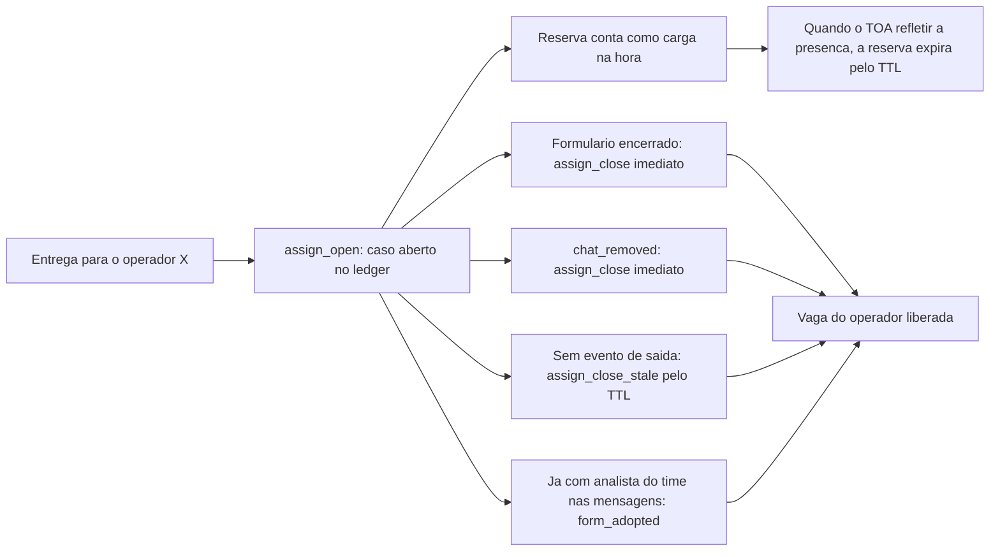

### 8.6 Como auditar uma decisao

O detalhe gravado em `bot_events` mostra o que foi contado e por que alguem foi descartado:

```text
time=T1; estrategia=round_robin; cap=4; membros=ana,bia; janela=ana:08:00-18:00;
fora_horario=bia:22:00-06:00; fim_janela=ana:5min; sem_online=—; proprio_bot=—;
so_chat=—; no_cap=ana; casos=ana=4,bia=0; carga=ana=3,bia=0; tentativas=1; rr=bia-ana; last=bia
```

- `casos` = solicitantes distintos; `carga` = contagem do proprio tipo - os dois alimentam os limites.
- `so_chat` = membro que nao recebe formulario; `no_cap` = descartado pelo cap; `sem_online` e `fora_horario` explicam as demais exclusoes.
- `fim_janela` = membro cortado pela margem de fim de escala do formulario (com quantos minutos faltavam); `proprio_bot` = o endereco do proprio bot, descartado por decisao nenhuma poder entrega-lo a ele.

### 8.7 Fila de espera com posicao (chat e formulario)

A propria `pending_routes` e a fila: `kind` (`chat` ou `form`), `team_id`, `expires_at` e `last_position`.

| Etapa | O que acontece |
|---|---|
| Entrada | em **qualquer** opcao de transferencia (`transfer_only` e `ask_and_transfer`, com ou sem perguntas) e tambem no **formulario**: o bot tenta entregar na hora; sem ninguem elegivel, a rota fica `waiting` |
| Aviso | o tecnico recebe o texto `queue_progress` ("Voce avancou na fila") na entrada e **so quando a posicao melhora**; com `queue_show_pos=true` ele recebe `queue_position` (com `{pos}`) enquanto a posicao estiver dentro de `queue_top_pos`. O formulario espera em silencio (nao existe chat para avisar) |
| Posicao | FIFO **por time e por LINHA**: o chat conta so chats, o formulario conta so formularios (`kind` entra na conta) |
| Varredura | a cada 5 s o tick le a cabeca de **cada linha** e alterna por qual comeca; um formulario novo nao espera os chats que entraram antes dele. Respeita cap/janela/online e grava `queued_assigned` com `espera=NNs`. Com a **fila desabilitada** no painel (ou o **bot desligado**) o tick **nao entrega nem recupera** nada e **devolve o que estava esperando**: encerra a rota com o motivo (`fila_desabilitada`/`bot_desligado` em `detail`) e **sai do chat em silencio** (eventos `queue_off`/`form_queue_off` + `left`), sem falar nada no chat |
| Saida | atribuido (`done`); **tecnico saiu do chat** ou chat removido (rota `failed` + `leave`); item **ausente nas listas do TOA** (`chat_resolvido_toa`/`form_resolvido_toa`); **fila desabilitada / bot desligado no painel** (`failed` + `left`); ou **Encerrar espera** no painel (fallback do time). A espera **nao vence sozinha** |

Com a fila **ligada**, o formulario **nao gasta tentativas** (`form_route_attempts`) nem cai no
fallback: ele espera a vez e vai sendo liberado conforme a carga dos analistas diminui. Tentativas e
fallback do formulario valem com a fila **desligada**.

- `queue_wait_enabled=false` devolve o comportamento antigo: N tentativas (`transfer_attempts`) e depois fallback.
- A fila vive no banco: kill/restart nao perde posicao nem o aviso ja enviado (`last_position`).
- **Sem prazo:** nao existe mais `queue_max_wait_sec` — a rota nasce sem `expires_at` (o campo continua na tabela apenas como marcador do botao **Encerrar espera**). O timeout antigo encerrava o chat sem transferencia quando o time ficava saturado.
- Na aba **Roteamento** o card **Fila de espera (agora)** mostra posicao, solicitante, tempo de espera, tentativas, **proxima tentativa** e o prazo ("sem prazo"); um alerta no topo da pagina ("N aguardando na fila agora") linka direto pro card (`#fila-espera`). **Encerrar espera** encerra na hora e deixa o motor aplicar o fallback.
- **Priorizacao manual (painel):** `pending_routes.priority` (0 por padrao) fura a fila da propria linha (chat/formulario) e do proprio time — ordem real e `priority DESC, id` (`db.due_routes`, `db.queue_position`). Botao **Priorizar**/**Remover prioridade** no card; entre varios priorizados a ordem continua por chegada.
- **Tentar agora (painel):** zera o `next_try_at` de um item especifico (`db.retry_route_now`), ignorando o backoff do retry (`transfer_retry_interval_sec`/`form_route_retry_interval_sec`, 60s por padrao) sem mudar o ajuste global.
- **Acordar a fila ao liberar vaga:** fechar um caso (`Engine._close_case`, qualquer motivo) chama `db.wake_team_routes` e zera o `next_try_at` de quem aguarda o backoff natural no mesmo time. Sem isso um item podia ficar ate 60s parado mesmo com um analista liberando vaga logo em seguida — o tick (5s) so olha rotas com `next_try_at` vencido.
- Quando a rota do chat e encerrada por outro motivo (tecnico saiu, chat removido, ausencia no TOA), a linha em `pending_routes` e fechada junto, para o tick nao insistir num chat que nao existe mais.
- **Fila desabilitada (ou bot desligado no painel):** o bot **nao fica dentro** de um quadro que o operador tirou dele. A espera e **encerrada com o motivo** (`fila_desabilitada`, `bot_desligado` no `detail` da rota e em `route_assignments.close_reason`) e o chat volta ao quadro **em silencio** (`leave_chat`, sem mensagem ao tecnico); o formulario apenas deixa de ser oferecido (`form_queue_off`, rota `failed`). Cada tick devolve ate **10 chats** (`_LEAVE_BUDGET`) — o resto sai nos ciclos seguintes. Tambem sai quem **ja foi entregue**: a varredura olha os chats vivos (`db.resume_chats`), nao so as rotas em espera. Antes a rota era **segurada** `waiting` para voltar sozinha ao religar — na pratica o item ficava invisivel para as duas recuperacoes (`due_routes` so ve o que venceu; a recuperacao exige chat **sem** rota) e so voltava pelo botao *Reabrir rota*. **Religar nao retoma**: quem entrega e uma pessoa.

### 8.8 Entrega robusta (FASE A)

A entrega ganhou registro unico e travas no banco (antes a protecao era so `chats.moved_at`, escrito
depois do ACK, e um `route_seen` sem atomicidade).

| Campo (`pending_routes`) | Papel |
|---|---|
| `invite_target` | alvo escolhido, **imutavel** nas retentativas (nao troca de analista no meio) |
| `move_sent_at` | marca de que o `move_chat` ja foi enviado (chat **e** formulario) — sobrevive ao restart |
| `case_key` / `requester_addr` | identidade do caso gravada na entrega (o chat nao perde mais o `case_key`) |
| `claimed_by` / `claimed_at` / `claim_expires_at` | posse (lease) da entrega: uma execucao por vez |
| indice unico `pending_routes_active` | **uma** operacao ativa por `(kind, chat_id)`, garantida no banco |

- `delivery_attempts` registra cada chamada externa de entrega (`move_chat`, `invite_to_chat`,
  `leave_chat`) com alvo, `r` do TOA, resultado (`ok`/`timeout`/`error`) e latencia; o detalhe do
  evento `transferred` passou a trazer `move=`/`invite=`.
- Teto de `move_chat` recusado (chat **e** formulario): conta em `pending_routes.move_fails` e a rota
  encerra (`chat_move_refused`/`form_move_refused`) em vez de girar para sempre. Config:
  `move_max_fail` (fallback `form_move_max_fail`, padrao 3).
- Ledger: `route_assignments.close_reason` (`chat_removed`, `stale_boot`, `form_done`, `ttl`, `manual`)
  e varredura de boot (`_sweep_stale_cases`) que fecha o caso quando o TOA nao mostra mais o item,
  respeitando `case_stale_confirm_sec`; `resume_stale` tambem fecha. **`resume_stale` encerra a rota
  `waiting` do chat** (`finish_routes_for_chat`): sem isso a rota ficava `waiting` para sempre e o
  tick tentava `move_chat` num chat que o bot nao conduz (o loop `e=10` das rotas orfas).
- Contencao: a cada `tick_timeouts` o bot roda `finish_orphan_routes` (fecha rota de chat cujo chat
  saiu do conjunto aberto, respeitando lease) — evento `orphan_route_closed`.
- Eventos novos: `case_closed`, `delivery_duplicate_blocked`, `delivery_target_locked`,
  `delivery_failed_no_team`, `delivery_recovered`, `chat_move_refused`, `orphan_route_closed`.
- Painel (aba Roteamento): **Entregas paradas e sem dono** (rotas `failed`/`cancelled` + chats
  `classified` sem rota, com *Reprocessar*) e **Casos abertos (ledger) e tentativas (24 h)**
  (com *Liberar*), alem do `close_reason` visivel.


### 8.9 Analista offline: o caso volta para a fila (resgate em 28/09)

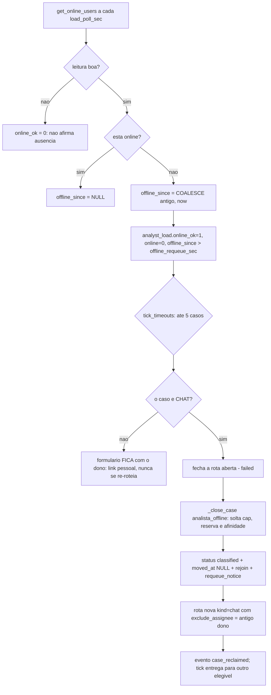

- **Regua:** `offline_requeue_sec` (global, padrao **120 s**) — o time sobrescreve em `team_routing.offline_requeue_sec` e **`0` desliga** naquele time; `offline_requeue_enabled` (global) desliga em tudo.
- **Como o "offline" e medido:** `snapshot_load` ja consulta `get_online_users` para todo mundo a cada `load_poll_sec`; agora grava `analyst_load.online_ok` (a leitura respondeu?) e `offline_since` (carimbo da **primeira** leitura que viu o analista offline). **Leitura falha nunca devolve caso de ninguem** — o resgate exige `online_ok=1`.
- **O que o robo faz (por caso, ate 5 por tick) — so CHAT:** encerra a rota aberta, fecha o caso no ledger (`close_reason=analista_offline`, liberando cap/reserva/afinidade), volta o chat a `classified`, limpa `moved_at`, entra no chat, avisa `requeue_notice` (“Operador ficou offline, transferindo para outro operador”) e cria **rota nova** com `pending_routes.exclude_assignee` = o antigo dono (a rota socorrida nao pode voltar para ele — nem pela afinidade, nem com `require_online=false`); na fila ele segue recebendo posicao.
- **Formulario NAO se re-roteia:** o formulario de validacao e um **link pessoal do analista**; move-lo para outra pessoa deixa o caso orfao e mexe no quadro dos dois (efeito observado em 28/09). O formulario fica com o dono ate o TTL de caso orfao (`route_assign_ttl_sec`) fechar o registro no ledger.
- **Fila desabilitada:** o resgate nao cria rota nenhuma para uma fila desligada no painel (o bot nao atua nela: a rota nasceria e seria encerrada na hora, devolvendo o chat) — o caso fica como esta ate a fila voltar.
- **Guardas do TOA:** formulario que ainda aparece com o dono offline dentro recusa o `move_chat` (`e=10`): o bot **nao adota** esse dono e **nao consome** o teto de `move_fails` (a rota espera ele sair); no chat, se o novo move for recusado, o bot **convida mesmo assim** (`reclaim_invite_only`).
- **Sem acao no painel:** o resgate roda sozinho no tick (ate 5 casos por tick); o painel so **configura** a regua (aba Roteamento: liga/desliga + segundos, por time na linha do time) e **mostra** o resultado.
- **Configuracao:** Roteamento (liga/desliga + segundos; por time na linha do time), Templates (`requeue_notice`), Atividade (`case_reclaimed`, `reclaim_invite_only`, `reclaim_no_queue`) e a coluna **Offline ha** + alerta na aba Carga.

### 8.10 Analista entra no chat da fila: o caso e dele e o bot sai

A fila nao bloqueia o chat — o tecnico continua falando com o bot enquanto espera, e um analista pode
entrar por conta propria. Quando isso acontece:

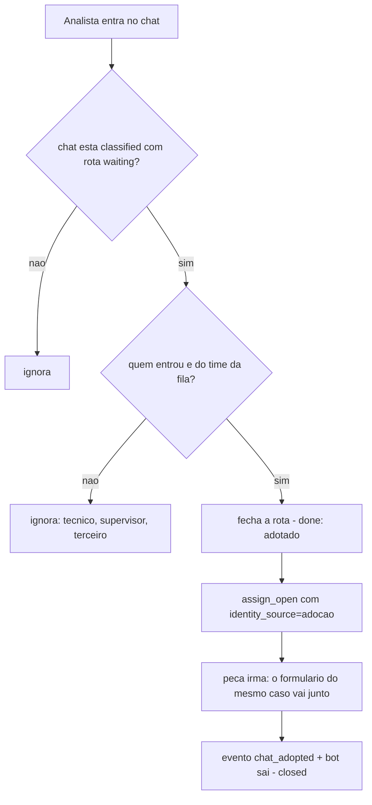

- **Dois ganchos** (o caso e o mesmo): a nota `user_joined` de um membro do time (`_note_join_analista`)
  e a checagem **antes de falar de fila** (`_queue_notify` → `_analista_presente`, lendo os
  `participants` presentes do payload mais recente do chat). O segundo cobre nota perdida (restart,
  janela de WS cego) e e o que evita o aviso "voce avancou na fila" para um chat que ja tem dono.
- **Por que importa:** sem isso o bot nao registrava o dono (o caso nao contava no cap/afinidade dele) e
  o tick seguinte podia **entregar o mesmo chat para outro analista** (dupla atribuicao).
- Ignorados de proposito: o proprio bot, o tecnico que abriu o chat (`started_addr`) e quem nao e do
  time da fila — `user_joined` de terceiro nao muda nada.

## 9. Timers e saude do processo

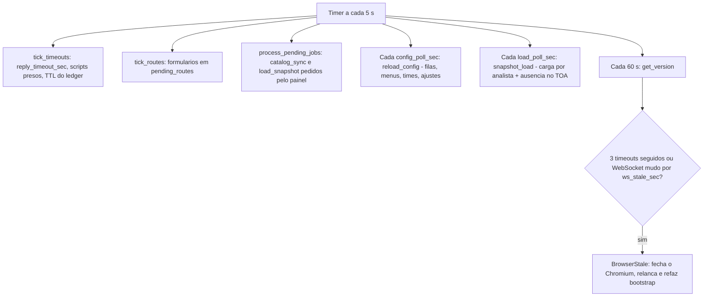

| Ajuste | Padrao | Para que serve |
|---|---|---|
| `reply_timeout_sec` | 300 | tempo de **silencio do tecnico** antes de encerrar (conta a ultima resposta em `last_reply_at`) |
| `max_invalid_retries` | 3 | respostas invalidas antes de encerrar |
| `config_poll_sec` | 15 | intervalo de recarga das configuracoes |
| `ws_stale_sec` | 180 | WebSocket mudo que dispara reciclagem |
| `route_assign_ttl_sec` | 43200 | TTL do caso orfao no ledger |
| `route_reserve_ttl_sec` | 300 | validade da reserva de carga |
| `form_move_max_fail` | 3 | recusas de `move_chat` no formulario (`e=10`) antes de encerrar a rota (`form_move_refused`) |
| `form_idle_offer_min` | 30 | minutos sem mensagem nova (e sem analista do time dentro) para o formulario **deixar de ser oferecido** na abertura |
| `form_idle_close_min` | 120 | minutos sem sinal de vida para o formulario **sair do indice** e o caso fechar (`form_closed motivo=form_ocioso`) |
| `form_idle_owner_close_min` | 240 | mesma janela, mas para formulario parado **com analista do time dentro** (`motivo=form_ocioso_analista`) — o TOA nao avisa quando ele sai |
| `queue_top_pos` | 5 | posicao a partir da qual o chat ouve o NUMERO da fila; acima disso recebe o texto de progresso (`0` = sempre fala o numero) |
| `queue_show_pos` | false | fala a POSICAO ao tecnico? `false` (padrao) = so "Voce avancou na fila", nunca o numero; `true` volta ao comportamento por `queue_top_pos` |
| `load_poll_sec` | 30 | intervalo da leitura das listas do TOA que alimenta a aba **Carga** (`snapshot_load`) |
| `form_absent_readings` | 2 | leituras consecutivas **bem sucedidas** sem o formulario em nenhuma lista para dalo como resolvido no TOA (`form_resolvido_toa`) |
| `analyst_load_keep` | 200 | leituras guardadas em `analyst_load_history` (podadas por id desc) |

### 8.9 Carga por analista e resolucao por AUSENCIA no TOA

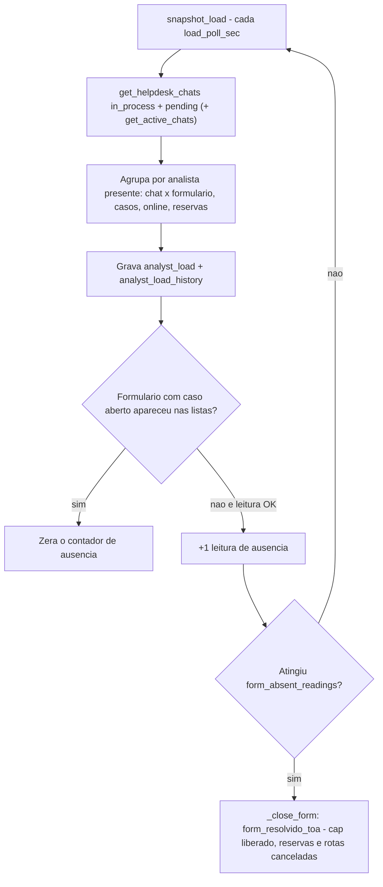

- **Ausencia vale para os DOIS tipos.** O caso de **chat** tambem morre quando o item sai das listas do TOA
  por `form_absent_readings` leituras boas (`chat_resolvido_toa`) — **`chats.status='closed'` nao serve de
  sinal**: e exatamente o que o bot grava ao entregar o chat e sair (o caso segue com o analista). So vale
  para chats cuja **fila foi lida** neste ciclo (fila fora do time nao gera falso positivo) e nunca com
  leitura falha.
- **A mesma leitura alimenta o cap.** `analyst_load.casos_toa_keys` guarda as chaves (autor) vistas no TOA em
  **todas as filas do time**, e a decisao conta `fisico (por autor) + reservas em voo` — o ledger e a fila do
  item sao **fallback**, usados so quando a leitura daquele analista esta velha ou falhou. Assim o cap, a
  tabela e o fisico do front falam o mesmo numero (a mesma peca nao conta 2x por ter duas chaves).
- **Quem le o que.** A leitura usa a MESMA fonte da capacidade (`route_capacity_source`): a lista
  `in_process` do front (chats **e** formularios em atendimento) e a `pending` (fila). O agrupamento por
  analista segue `_participante_presente` (participante presente ou `assignedUser.active`), e o caso usa a
  mesma identidade do cap (`requester_key` com os operadores do time) — por isso `casos_total` bate com a
  carga que decide a entrega.
- **Ausencia e decisao, nao estimativa.** O TOA nao avisa que o analista resolveu o formulario: o sinal e
  ele **sumir da lista** na proxima leitura do front. Duas leituras consecutivas ausentes
  (`form_absent_readings`) com `toa_ok=true` fecham o caso (`close_reason=form_resolvido_toa`), cancelam as
  rotas presas (`form_route_cancelled`, se houver) e devolvem a vaga (o `_close_case` tambem solta a reserva).
- **Nunca decide no escuro.** Se qualquer leitura do ciclo falhar (timeout/erro), `toa_ok=0` e o contador
  nao anda; `analyst_load.toa_ok` fica 0 e a aba mostra **falhou**. Formulario no indice **sem** caso aberto
  e que sumiu do TOA sai do indice (`form_forget … motivo=ausente_no_toa`) pela mesma regua.
- **Reapareceu?** O contador zera (formulario voltou a ser listado) e o caso segue aberto — nada e fechado
  por engano. O contador e em memoria: restart tambem zera.
- **Painel.** Aba **Carga**: cards, nesta ordem — **ChatBot — Em atendimento** (chats com o bot: status de
  `resume_chats` e `moved_at IS NULL`), **Fila de chat**, **Chat em atendimento** (ledger), **Fila de
  formulario**, **Formulario em atendimento** (ledger) e **Ultima leitura**; e a tabela por analista com
  TOA chat/form, **Casos** (= fisico `TOA chat + TOA form`, com o numero de solicitantes distintos em cinza
  ao lado — as colunas do ledger "Bot chat/Bot form" sairam da visualizacao), reservas, formulario mais
  antigo e a hora da leitura. **Ordenacao:** quem esta **ativo no roteamento** (`team_members.active`)
  primeiro, maior carga fisica no topo; inativo (ou fora do time) vai para o fim, com selo `inativo`.
  **Filtro de time multiplo** vale para os cards, a tabela e os alertas, com o estado gravado na sessao.
  Atualizacao de 30 s (`load_poll_sec`) e o botao **Atualizar agora** (job `load_snapshot`). Permissao de
  pagina `page.load` e de acao `load.manage`.

## 10. Restart, resume e reciclagem

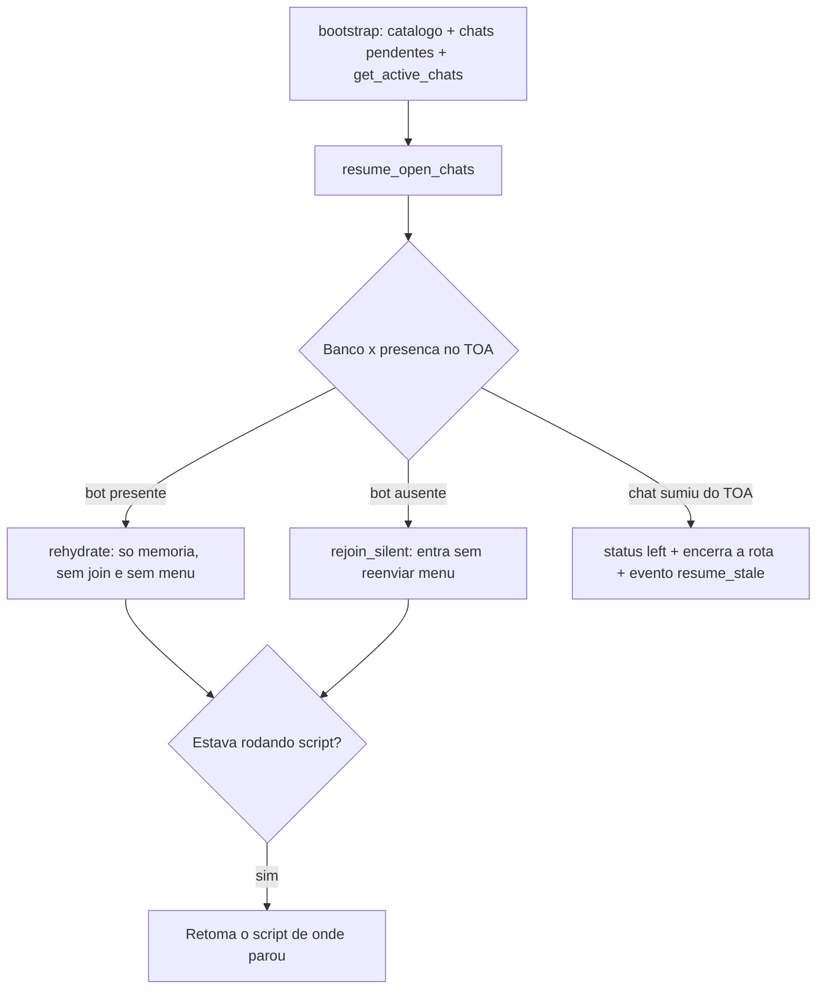

- Status retomados no restart: `joined`, `menu_sent`, `awaiting_reply`, `classified`, `monitoring`, `awaiting_script_answer`, `awaiting_script_confirm`, `awaiting_script_run`.
- O menu **nunca** e reenviado no resume: o tecnico continua do ponto em que estava.
- A fila de retry do formulario e o ledger ficam no banco, entao tambem sobrevivem ao restart.
- A coleta de perguntas (`chats.ask_option_id`) tambem: no boot o bot reenvia a pergunta ou a
  confirmacao atual (dentro do `reply_timeout_sec`) e a rota de transferencia enfileirada segue
  sendo drenada pelo tick.
- Logo depois do `resume_open_chats`, o boot chama `db.wake_all_routes` (evento
  `queue_wake_boot` quando acorda alguma): zera o backoff de TODA a fila pendente, para o
  primeiro tick depois do restart ja reavaliar tudo, sem esperar o primeiro `snapshot_load`
  natural (ate `load_poll_sec`, padrao 30s). Ver `docs/plano-correcao-fila-esquecida.md`.

## 11. Banco de dados: 31 tabelas e o papel de cada uma

### Catalogo do TOA

| Tabela | Papel |
|---|---|
| `queues` | filas (`h:...`) com nome e o liga/desliga do bot (`enabled`) |
| `queue_operators` | operadores por fila, vindos do `search_contact` ou cadastro manual |
| `transfer_targets` | destinos de transferencia — **hoje o motor nao usa** |

### Menu e atendimento

| Tabela | Papel |
|---|---|
| `menus` | menus nomeados |
| `menu_queues` | menu ligado a 1 fila |
| `menu_options` | opcoes raiz e filhas: `label`, `classification`, `action`, `reply_text`, `script_slug` (`action_if_form`/`reply_text_if_form` ficaram como **legado sem uso**) |
| `menu_option_targets` | alvos por opcao — **hoje o motor nao usa** |
| `templates` | textos: `greeting`, `menu`, `retry`, `closing`, `ask_received`, `ask_transferring`, `queue_position`, `queue_progress`, `queue_expired` (os da abertura form-aware sairam em 28/09) |
| `menu_option_questions` | perguntas da opcao `ask_and_transfer`, coletadas no chat antes de transferir |

### Times e roteamento

| Tabela | Papel |
|---|---|
| `teams` | times (plantao) |
| `team_members` | membros: ordem, ativo, janela `route_start`/`route_end`, `last_assigned` legado |
| `team_queues` | fila ligada a 1 time — base do roteamento de **chat e formulario** |
| `team_routing` | politica do time: estrategia, caps, online, janela, tentativas, fallback, recebe formulario, rodizio por tipo |
| `team_member_routing` | peso e caps por membro |
| `route_assignments` | **ledger dos casos**: quem atende cada solicitante, `case_key`, contato do solicitante e `closed_at` |
| `pending_routes` | **fila de espera**: retry do formulario (`kind=form`), fila do chat com posicao (`kind=chat`, `expires_at`, `last_position`) e trava anti-duplicidade |
| `delivery_attempts` | **medicao de cada entrega**: operacao, alvo, `r` do TOA, resultado (`ok`/`timeout`/`error`) e latencia |
| `analyst_load` | **medicao por analista** (aba Carga): ultima leitura das listas do TOA (chats x formularios), ledger, reservas, `form_ocioso_min`, `form_presente_toa`, `toa_ok` |
| `analyst_load_history` | historico curto das leituras (podado por `analyst_load_keep`) |

### Estado e observabilidade

| Tabela | Papel |
|---|---|
| `chats` | estado por `chat_id`: status, classificacao, retries, timestamps, script |
| `bot_events` | log de eventos — **sem texto de conversa** |
| `bot_jobs` | pedidos do painel: `catalog_sync` e `load_snapshot` |
| `bot_settings` | parametros globais |
| `bot_users` | usuarios do painel (`display_name`, `operator_address`, `group_id`, `last_login_at`) |

### Painel (RBAC) — criadas na Fase 1

| Tabela | Papel |
|---|---|
| `permission_groups` | grupo de permissao do painel (`is_super` = Super Admin) |
| `group_permissions` | chaves de permissao do grupo (o catalogo de chaves fica no PHP) |
| `group_teams` / `group_queues` / `group_menus` | **escopo de dados do grupo**: times, filas e menus que ele enxerga |
| `user_teams` / `user_queues` | legado (escopo por usuario da primeira versao); a migracao copia para o grupo |

Filas visiveis = filas de `group_teams` (via `team_queues`) + `group_queues`; sem
marcacao e sem `scope.all_*` o grupo nao ve dado nenhum (negar por padrao). O motor
de atendimento **nao le** nenhuma dessas tabelas; `bot_migrate_rbac` (PHP) e
`_migrate_rbac` (Python) sao espelhos e rodam duas migracoes uma unica vez cada:
`rbac_seeded` (promove usuarios legados a Super Admin) e `rbac_scope_groups`
(copia `user_*` -> `group_*`).

### Dois backends: SQLite (padrao) e MySQL 8

O DDL e **um so** (`schema.sql`) e o dialeto tambem: o codigo continua escrito em SQLite e o
`python/sqlcompat.py` traduz na hora do `execute` (*choke point*). Quem escolhe o backend e
`config.db_backend()` (`DB_BACKEND` no `.env`; padrao **`sqlite`**).

| | `DB_BACKEND=sqlite` (padrao) | `DB_BACKEND=mysql` |
|---|---|---|
| Conexao | `sqlite3` direto + `PRAGMA foreign_keys/WAL/busy_timeout` | `PyMySQL` + traducao no `sqlcompat.connect()` |
| DDL | `schema.sql` como esta | o **mesmo** `schema.sql` traduzido (FK de coluna -> `CONSTRAINT`, `AUTOINCREMENT` -> `AUTO_INCREMENT`, colunas de chave `TEXT` -> `VARCHAR(191)`) |
| Datas | `datetime('now')` | `UTC_TIMESTAMP()` (sessao em `time_zone='+00:00'`) |
| `PRAGMA` | valem | viram `SET`/`SELECT`; o `PRAGMA foreign_keys` do proprio script **sai** (`sem_pragma_fk`) |
| Testes | suite completa, offline | os mesmos testes, sem tocar no banco remoto |

- O boot (`db.ensure_schema`) cria as tabelas com a checagem de FK **desligada** — o `schema.sql`
  cria na ordem em que foi escrito, que **nao** e a ordem das FKs (`bot_users` e a tabela #1 e
  referencia `permission_groups`, que nasce so na #25) — e religa no fim.
- As FKs tem de ser de **tabela** (`CONSTRAINT ... FOREIGN KEY`): o MySQL **descarta em silencio**
  o `REFERENCES` escrito na coluna (medido: 30 FKs antes/depois do tratamento, 0 sem ele).
- Painel PHP: a bifurcacao (`php/db.php` com `BotPDO`/`BotStatement`) e a **Fase 3** do plano
  `sqliteformysql.md`; hoje o painel so abre SQLite.


## 12. Onde cada coisa se configura no painel

| Aba | O que se configura |
|---|---|
| **Dashboard** | volume de classificacoes por categoria no periodo, resumo dos eventos do formulario e **fila de espera do chat** (na fila agora, espera media e maior espera) |
| **Filas** | liga/desliga a fila para o bot e dispara a sincronizacao do catalogo |
| **Operadores** | operadores por fila, vindos do TOA ou cadastro manual |
| **Times** | time, membros, **Ordem**, **janela de plantao** e as filas do time (o endereco do proprio bot e recusado: ele so repassa o atendimento) |
| **Roteamento** | **globais** - bot ligado, formulario roteado, estrategia, fallback, caps, **fila de espera** (ligada/desligada e espera maxima), **resgate de analista offline** (`offline_requeue_enabled` + `offline_requeue_sec`) e **margem de fim de janela do formulario** (`form_window_margin_min`, min antes da escala acabar em que ele deixa de ser oferecido) - **por time** - estrategia, caps, online, plantao, tentativas, fallback, recebe formulario, a margem de fim de janela e `offline_requeue_sec` (0 = o time nao devolve) - **por membro** - peso, cap chat, cap form, casos e recebe formulario |
| **Menus** | menus, opcoes, submenus, acao/texto normais, **acao/texto se formulario aberto** e scripts |
| **Templates** | textos `greeting`, `menu`, `retry`, `closing`, `ask_received`, `ask_transferring`, `queue_position` (posicao na fila de espera), `queue_progress`, `queue_expired` e `requeue_notice` (operador offline) |
| **Atividade** | log de eventos com filtro por tipo e atualizacao automatica na primeira pagina |
| **Carga** | leitura das listas do TOA por analista (`analyst_load`): TOA x bot, casos, reservas, formulario mais antigo e a hora da leitura; **Atualizar agora** forca a leitura (job `load_snapshot`) |
| **Chats** | estado dos chats, sem conteudo de conversa |
| **Ajustes** | timeout de resposta, retries invalidos, poll de config e reciclagem do WebSocket |
| **Usuarios** (super-only) | contas do painel: login, senha, nome, address do TOA e grupo (o escopo herdado aparece em leitura) |
| **Grupos** (super-only) | permissoes (paginas, acoes e `scope.all_*`) **e** o escopo de dados: times, filas e menus do grupo |

## 13. Eventos registrados em bot_events

| Grupo | Eventos |
|---|---|
| Entrada e assuncao | `assumed`, `menu_sent`, `not_new`, `queue_off`, `queue_unknown`, `bot_off`, `join_failed` |
| Conversa e desfecho | `ignored_reply`, `reply_replayed`, `send_failed`, `classified`, `transferred`, `no_agent`, `closed_invalid`, `closed_timeout`, `closed_no_agent`, `left`, `resume_stale` |
| Scripts | `script_ok`, `script_error`, `script_denied` |
| Formulario de validacao | `closure`, `form_routed`, `form_no_agent`, `form_route_retry`, `form_no_team`, `form_no_queue`, `form_adopted` (ja estava com um analista do time), `form_move_refused` (`move_chat` recusado no teto), `form_skip_past` (formulario encerrado nao entra na fila) |
| Caso/formulario | `case_link_unconfirmed`, `case_sibling_delivered`, `case_key_divergente`, `case_closed` (a abertura form-aware foi removida em 28/09) |
| Indice do formulario | `form_indexed`, `form_not_open`, `form_dropped`, `form_ignored_payload`, `form_queue_left`, `form_forget` (inclui `motivo=ausente_no_toa`), `form_state` (pendente/em atendimento/passado), `form_closed`, `form_resolvido_toa` (ausente das listas do TOA por `form_absent_readings` leituras: fecha o caso e libera a vaga), `form_route_cancelled` |
| Carga por analista | `analyst_load` (resumo de cada leitura: analistas, itens vistos no TOA, `toa_ok` e quantos foram resolvidos por ausencia) |
| Resposta ignorada | `message_ignored` (mensagem do tecnico em status que o bot nao trata; antes era silencioso) |
| Identidade do caso | `case_key_divergente` (a chave da rota foi ignorada: a identidade do payload manda) |
| Catalogo | `catalog_synced`, `sync_error` |
| Perguntas antes de transferir | `ask_collected`, `route_retry` |
| Fila de espera | `queued`, `queue_position`, `queued_assigned`, `queue_expired` |
| Fila desabilitada / bot desligado | `queue_off`, `form_queue_off` (a espera e **encerrada** com o motivo `fila_desabilitada`/`bot_desligado` e o chat **sai em silencio**: `left`; o formulario deixa de ser oferecido) |
| Alvo proibido | `self_target_blocked` (o alvo da entrega era o **proprio bot**: nada e enviado ao TOA) |
| Analista offline (resgate) | `case_reclaimed` (caso devolvido a fila), `reclaim_invite_only` (chat: move recusado, so convida), `reclaim_no_queue` (caso sem fila) |
| Analista entra na fila | `chat_adopted` (analista do time entrou no chat que esperava: caso e dele e o bot sai) |
| Fila a prova de reinicio (ver `docs/plano-correcao-fila-esquecida.md`) | `analyst_available` (`snapshot_load` detectou que um analista ficou disponivel e acordou a fila do time dele, sem esperar o tick achar por acaso); `queue_read_degraded` (leitura do TOA falhando ha muito tempo para uma fila — antes disso era silencioso); `queue_wake_boot` (boot acordou toda a fila, para nao esperar o 1o `snapshot_load` depois de voltar) |

## 14. Status possiveis do chat

| Status | Significado |
|---|---|
| `detected` | chat identificado, ainda sem presenca confirmada |
| `joined` | bot entrou no chat |
| `menu_sent` | menu enviado |
| `awaiting_reply` | esperando o digito, com timeout |
| ~~`awaiting_form_choice`~~ | **removido em 28/09** (abertura form-aware); chats antigos nesse status sao ignorados |
| `awaiting_script_answer` | script: preenchendo campo |
| `awaiting_script_confirm` | script: confirmando os dados |
| `awaiting_script_run` | script: execucao em andamento |
| `classified` | folha aplicada, com classificacao gravada |
| `monitoring` | bot fica no chat sem menu, aguardando desfecho |
| `closed` | encerrado pelo bot apos transferir ou responder |
| `closed_invalid` | encerrado por respostas invalidas |
| `closed_timeout` | encerrado por silencio real do tecnico (resposta perdida no restart e recuperada em `reply_replayed`) |
| `closed_no_agent` | encerrado por nao haver analista elegivel e fallback close |
| `closed_originator_left` | o tecnico saiu |
| `left` | chat removido ou bot saiu |

Quem esta na fila de espera continua em `classified` ate ser atribuido (`closed`), o tecnico sair (`closed_originator_left`) ou a espera ser encerrada no painel (fallback do time: `closed_no_agent` ou `monitoring`). O vencer por tempo nao acontece mais sozinho.

## 15. O que ainda nao existe

| Item | Situacao |
|---|---|
| **Fila de espera com posicao** | **feita Fase 2** - vive na `pending_routes` (nao numa `route_queue` a parte): posicao FIFO por time, aviso no chat e silencio no formulario |
| **Abertura form-aware** | **removida em 28/09**: associava errado o formulario ao chat; agora o chat de fila sempre recebe o menu |
| **Painel da fila de espera** | **feito Fase 2** na aba Roteamento: posicao, tempo de espera, tentativas, vencimento e "Encerrar espera". "Vagas do time" nao entram: dependem da presenca ao vivo do TOA, que o painel nao enxerga |
| **Metricas de espera** | **feitas Fase 2**: card "Fila de espera do chat" no Dashboard (na fila agora, espera media e maior espera do periodo) |
| `action_if_form` / `reply_text_if_form` do menu | **legado sem uso**: o painel grava vazio e o motor ignora (removido junto com `has_open_validation_form`); a abertura form-aware ficou no vinculo do caso (secao 4.1) |
| `transfer_targets` e `menu_option_targets` | **codigo morto**: o motor sempre roteia pelo time; decidir entre implementar ou remover da UI |
| `CHAT_TYPE_ROUTING` do TOA | existe um modo de roteamento nativo no TOA - vale investigar como bonus |
| Escopo do `get_active_chats` | validar em producao: o campo `carga_toa=` no detalhe mostra quantos chats o bot enxergou |
| **Vagas do time ao vivo** | **parcial**: o painel nao fala com o TOA, mas o bot publica a presenca e a carga por analista na aba **Carga** (`analyst_load`) e usa essa leitura para fechar por **ausencia** o formulario resolvido |

## 16. Como rodar e testar

```bash
# Bot - completa o login na primeira vez e guarda a sessao em .chrome-profile/
.venv\Scripts\python run.py

# Testes Python - um arquivo por vez
python tests/test_case_cap.py
python tests/test_routing.py
python tests/test_form_route.py
python tests/test_form_open.py
python tests/test_form_aware.py
python tests/test_ask_flow.py
python tests/test_queue.py
python tests/test_load.py
python tests/test_offline_reclaim.py
python tests/test_reply_lost.py

# Suites PHP
php tests/test_routing_schema.php
php tests/test_submenu_schema.php
php tests/test_rbac_schema.php
php tests/test_permissions.php
php tests/test_queue_schema.php
php tests/test_questions_schema.php
php tests/test_delivery_schema.php
php tests/test_form_aware_schema.php
php tests/test_load_schema.php
php tests/test_panel_render.php

# Suite Python completa (24 arquivos) - cada um roda sozinho, no backend padrao (sqlite)
Get-ChildItem tests\test_*.py | ForEach-Object { python $_.FullName }

# Backend que o bot usaria agora (le o .env)
python -c "from python.config import load_env, db_backend; load_env(); print(db_backend())"
```

---

**Resumo em uma frase:** o bot assume o chat da fila habilitada (**com menu ativo e time ativo — sem isso nao entra**), oferece o menu, classifica a folha escolhida e entao decide quem recebe - contando **casos por solicitante** no TOA, no ledger e nas entregas em voo - com **afinidade** para o formulario do mesmo tecnico, **fila de espera com posicao e sem limite de tempo** no chat (o tecnico so sai quando um analista aparece, ele mesmo sai ou alguem usa *Encerrar espera*), timeout medido por **silencio real do tecnico** com recuperacao da resposta que chegou com o bot fora, e retry assincrono para o formulario (que exige a MESMA fila habilitada + time ativo do chat), que nunca entra na conversa nem e encerrado pelo bot.

