# HELPTOA Bot — desenho do fluxo atual

> Retrato do codigo em 22/09/2026. Cobre **atendimento**, **menu**, **abertura form-aware**, **roteamento por caso**, **formulario de validacao**, **timers**, **banco** e **painel**.
> Diagramas em Mermaid — renderizam no VS Code, GitHub e na maioria dos visualizadores de Markdown.

## 1. Visao de contexto

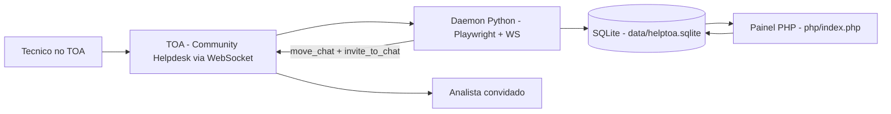

- O bot **nao usa API HTTP** para operar: fala com o TOA pelo WebSocket nativo da sessao, aberto pela propria pagina, e reaproveita a sessao do Chromium em `.chrome-profile/`.
- O banco guarda **so** `chat_id`, status, classificacao, retries e timestamps — nenhum texto de conversa.

## 2. Componentes

| Arquivo | Papel |
|---|---|
| `run.py` | entrada do daemon |
| `python/main.py` | ciclo de vida: lock, navegador, `run_once`, timers de 5 s, reciclagem do Chromium |
| `python/auth.py` | login/SSO no TOA, escolha da pagina ativa |
| `python/toa.py` | `ToaSocket`: envia comandos `a/d/r`, recebe notes, guarda `own_address` |
| `python/engine.py` | **cerebro**: assumir chat, abertura form-aware, menu, scripts, classificacao, transferencia, formulario, roteamento |
| `python/routing.py` | motor puro de decisao: heranca de ajustes, filtros, estrategia e detalhe de diagnostico |
| `python/form_open.py` | deteccao do formulario, **identidade do solicitante** e **correlacao com o chat do tecnico** |
| `python/db.py` | SQLite: acesso, migracoes, **ledger de casos**, jobs |
| `python/resource_profile.py` | valida perfil de gestor do operador nos scripts |
| `python/scripts/` | scripts de apoio (`criar_apoio`, `criar_infra_rede`) + `registry.py` + `manifest.json` |
| `schema.sql` | DDL aplicada tanto pelo Python quanto pelo PHP |
| `php/index.php` + `php/bootstrap.php` | painel: abas, acoes POST, render e migracoes |
| `tests/` | 274 testes Python + 9 suites PHP |

## 3. Entrada de um chat: assumir ou ignorar

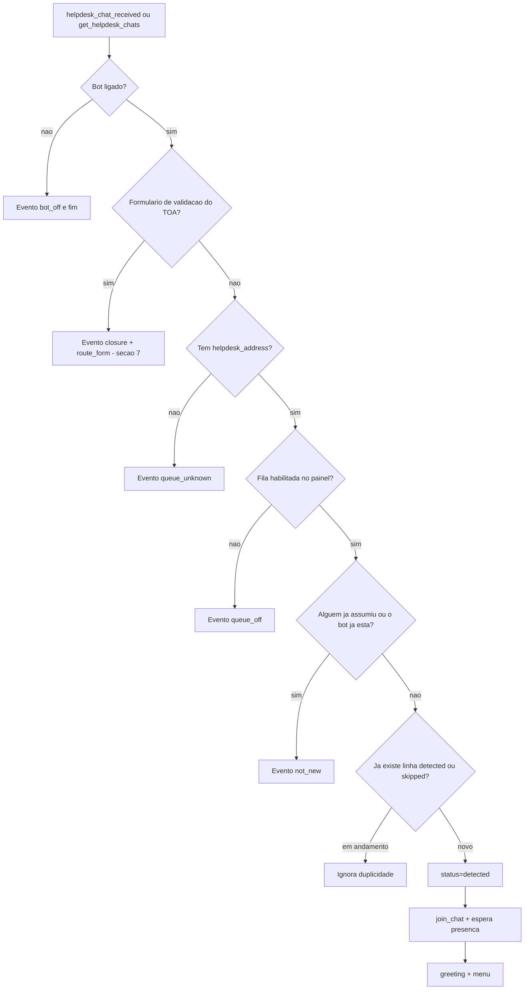

**Registro de cada passo:** `bot_events` (ver secao 13) e `chats` (ver secao 14).
Se o tecnico que abriu o chat de fila **ja tem formulario de validacao aberto**, a
assuncao cai na **abertura form-aware** (secao 4.1) em vez do menu.


## 4. Menu, submenu, digito, retries e timeout

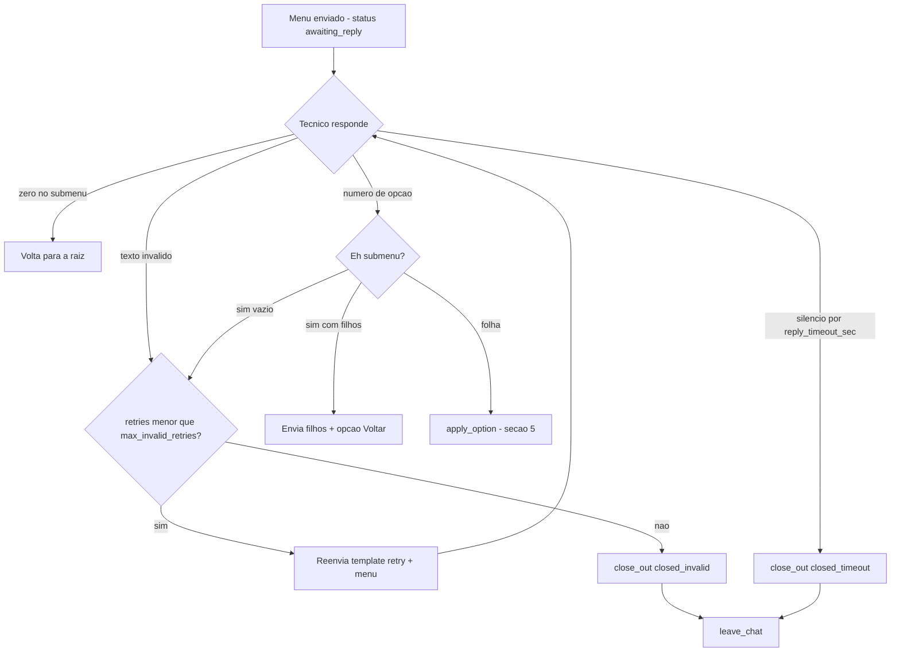

- Raiz = `greeting` + `menu` + opcoes. Submenu = titulo + filhos + `0) Voltar`.
- A opcao e escolhida pelo `sort_order` igual ao digito.
- O timeout vale tambem dentro do submenu, porque reusa o mesmo `last_prompt_at`.
- O estado (`awaiting_reply` + `last_prompt_at`) e gravado **antes** do `send_message`: a resposta que
  chega enquanto o ACK do envio esta em curso (ate 8 s quando o TOA nao devolve eco) nao se perde.
- O cronometro mede **silencio do tecnico**: qualquer mensagem do solicitante atualiza `last_reply_at`
  e reinicia a contagem (resposta invalida tambem conta). `closed_timeout` so acontece com silencio real.
- Ao voltar de restart/reciclagem, `replay_pending_reply` le as ultimas mensagens do chat no TOA e
  processa a resposta que chegou com o bot fora (evento `reply_replayed`), antes de qualquer timeout.
- Retries sao contados em `chats.retries`; template `retry` e configuravel na aba Templates.

### 4.1 Abertura form-aware: o tecnico ja tem formulario em andamento

Quando o bot assume um chat de menu e o **mesmo tecnico** tem um formulario de
validacao aberto, em vez do menu ele oferece `1) Falar sobre o formulario` /
`2) Abrir o menu`. Chat e formulario passam a ser **um caso so** (`case_key`
unico no ledger): encaminhado um, o outro vai junto.

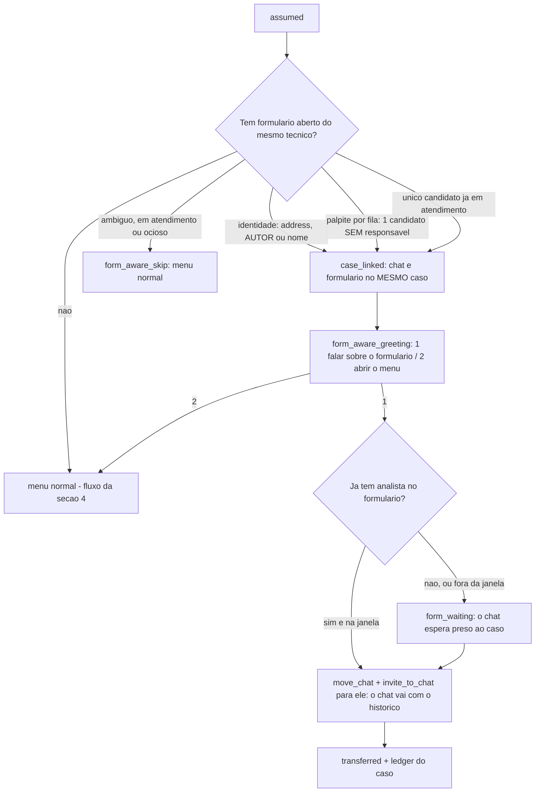

- **Correlacao** (`form_open.form_by_technician`), nesta ordem:
  1. **address** do payload do formulario contra quem abriu o chat;
  2. **AUTOR das mensagens do formulario** — a identidade que sobra quando o
     `message_scenario` chega sem o address do tecnico: ele responde no
     formulario, entao aparece como autor (staff, o bot, a fila `h:` e os
     analistas do time ficam de fora). A leitura das mensagens ja acontece para o
     estado, entao a identidade sai **sem chamada extra** (`regra=autor`);
  3. **nome**, quando `affinity_match_name` = true;
  4. **fila + recencia**, agora **so com um unico candidato SEM responsavel**
     (sem caso aberto no ledger e sem analista do time dentro pelas mensagens).
     Com dois ou mais candidatos sem identidade o vinculo e recusado
     (`form_aware_skip` com `ambiguo:<n>` ou `em_atendimento:<n>`) — adivinhar por
     recencia era o que juntava tecnicos diferentes no mesmo caso. Um unico
     candidato **ja em atendimento** ainda casa: e o tecnico abrindo o chat para
     falar do proprio formulario.
- **Janela de vida (`form_ocioso`):** o TOA **nao avisa a saida do analista**
  (`user_left` nao chega), entao formulario morto ficava no indice e no ledger
  ate o TTL de 12 h — enchia a fila (ambiguidade na abertura) e segurava a vaga
  do analista. Regras:
  - **Oferta:** sem mensagem nova por `form_idle_offer_min` (30 min) **e sem
    analista do time dentro**, ele deixa de ser oferecido
    (`form_aware_skip … ociosos=1`). Com analista dentro a oferta continua — o
    texto diz com quem ele esta.
  - **Fechamento:** sem sinal de vida por `form_idle_close_min` (120 min) fecha o
    caso (`motivo=form_ocioso`); **com analista do time dentro** vale a regua
    maior `form_idle_owner_close_min` (240 min) e o motivo e
    `form_ocioso_analista` — era exatamente o estado dos casos que travavam os
    caps: o analista entrou no formulario e o TOA nunca mostra a saida dele.
  - Fechar cancela as rotas presas (`form_route_cancelled`) e libera a vaga. O
    relogio de vida e o sinal **mais recente**: ultima mensagem -> `started_time`
    do closure -> `assigned_at` do caso no ledger -> relogio do indice (boot,
    ultimo recurso). Sem as duas referencias do meio, um formulario de horas
    atras parecia novo a cada restart e a janela de vida nunca fechava nada.
- **Indice enxuto:** a poda tira do indice o formulario cujo caso no ledger ja foi
  encerrado de verdade (`form_done`/`chat_removed` → `form_forget
  motivo=caso_encerrado`). Caso expirado por TTL/`stale_boot` **nao** descarta: o
  formulario pode estar aberto no TOA. Antes o indice so crescia (14 → 32 em 15
  min em producao) e a varredura seguia lendo no TOA o que a abertura ja ignorava.
- **Trava de identidade:** mesmo no palpite por fila, se a chave do caso do
  formulario aponta para **outro** address (`a:u:<outro>`), o vinculo e recusado.
  Sem isso o chat de um tecnico entrava no caso de outro (o caso que "trocava de
  analista" no painel). Vinculo vindo de palpite fica registrado em
  `case_link_unconfirmed`, com a regra usada.
- **Caso unico:** ao vincular, o ledger do formulario (`route_assignments`) e a rota
  dele passam a usar a chave do tecnico (`db.relink_case`, sem mexer em `assigned_at`).
  E isso que faz a afinidade (secao 8.2) entregar os dois ao mesmo analista.
- **Ramo 1 sem dono:** o chat entra na fila com `pending_routes.expects_owner = 1`
  (aviso `form_waiting`, sem posicao de fila) e **nao gasta tentativa nem cai no
  fallback**: o tick entrega assim que o formulario ganhar um analista elegivel.
- **Peca irma** (`_deliver_sibling`): quando um dos itens do caso e entregue, o outro
  (se ainda estiver esperando) vai junto para o mesmo analista (`case_sibling_delivered`).
- **Formulario encerrado:** as rotas presas ao dono voltam a ser rota normal
  (`expects_owner = 0`), para o chat nao ficar preso a um caso que acabou.
- **Estados do formulario** (espelham o `closureState` da extensao do TOA):
  **pendente** (ninguem pegou), **em atendimento** (o analista entrou) e **passado**
  (o analista saiu / atendimento concluido). O estado e lido das **mensagens do
  formulario** (`get_chat_messages`, so leitura: `system_message` de entrada/saida
  de quem nao e o tecnico nem o bot). So pendente e em atendimento interessam para
  a abertura; **passado sai de cena** (`form_closed`: sai do indice, o caso fecha e
  quem esperava por ele volta a rota normal). A leitura e feita no boot (para cada
  formulario reidratado), na abertura com leitura forcada (a resposta ao tecnico nunca sai de cache), antes de cada entrega (formulario passado nao entra na fila: form_skip_past) e numa varredura que revalida UM formulario
  por tick — a mesma "visao viva" que a extensao mantem. Se o TOA nao responder
  nada, **nao se decide**: formulario vivo nao cai por falha de leitura.
- **Vinculo definitivo:** um formulario ja oferecido a **qualquer** chat (mesmo
  encerrado) nao e oferecido de novo. Era o falso positivo do teste de 22/09: o
  chat do tecnico fechava, o formulario voltava a ficar "livre" e a abertura
  aparecia em um chat posterior, de outro assunto.
- **Identidade do caso (sem "balde"):** chave de caso **nunca** sai de nome
  generico. Sem o address do tecnico, a chave do formulario e **por item**
  (`chat:<id>`), entao cada formulario e um caso proprio e a afinidade nao junta
  solicitantes diferentes. Na entrega, a **identidade do payload manda** sobre a
  chave que ja estava na rota (a divergencia vira evento `case_key_divergente`).
  A migracao repara as chaves genericas antigas (`n:message scenario agent` →
  `chat:<id>`), sem fechar caso nenhum.
- **Afinidade entrega direto ao dono** — inclusive com o cap cheio (é o "um caso
  so" do desenho). O cap vale para o **rodizio**: quem esta no limite nao recebe
  item novo, que **espera na fila** (a mesma do chat) e vai sendo liberado
  conforme a carga dos analistas diminui.
- **Fila unica:** chat e formulario esperam na **mesma linha** (a posicao conta os
  dois tipos). Com a fila ligada o formulario **espera sem limite**, como o chat;
  `form_route_attempts`/fallback valem com a fila **desligada**. O formulario
  continua **sem anunciar posicao** (ninguem recebe mensagem nele).
- **Restart:** o bot nao e participante do formulario, entao `_open_forms` (memoria)
  e reidratado no boot a partir do ledger (`bootstrap` -> `_hydrate_open_forms`) e
  os reidratados passam pela leitura de estado (`_validate_open_forms`).
- **Textos (aba Templates):** `form_pending` (com `{analista}`), `form_pending_wait`
  (formulario ainda sem analista) e `form_waiting` (ramo 1 aguardando o dono). A
  migracao converte `\n` **literal** em quebra de linha real (a primeira versao da
  semente gravou barra+n, e o `INSERT OR IGNORE` nunca corrigia).
- **Indice do formulario:** o bot acompanha os formularios abertos em memoria
  (`_open_forms`). Ele **so sai** com fim explicito (payload com `lifecycle`
  removido/finalizado ou `ended_time` que seja data de verdade), com `chat_removed`,
  pelo TTL de 12 h ou quando o caso no ledger ja esta encerrado (`form_done`/
  `chat_removed`). Um `helpdesk_chat_removed` **nao** tira: e aviso de fila (o
  `move_chat` para o analista gera um destes) e o formulario continua aberto.
  Payload pobre (sem `mode`/`first_message`) tambem nao tira mais.
- **Diagnostico:** `form_indexed`, `form_not_open`, `form_dropped`,
  `form_ignored_payload`, `form_queue_left`, `form_forget` e `form_aware_skip`
  (com `abertos=`, `na_fila=`, `vinculados=`, `encerrados=`) deixam a decisao
  auditavel — antes, cada um desses caminhos falhava em silencio.
- **Boot:** `_hydrate_open_forms` roda **antes** do resume e a varredura de boot
  **nao** fecha caso de formulario (o bot nao e participante dele, entao ele nunca
  aparece em `get_active_chats` — a varredura fechava formulario vivo como
  `stale_boot`). O TTL (`route_assign_ttl_sec`) segue fechando caso orfao.
- Sem formulario vinculavel, **nada muda**: o menu normal continua igual.

## 5. Folha escolhida: onde a demanda e decidida

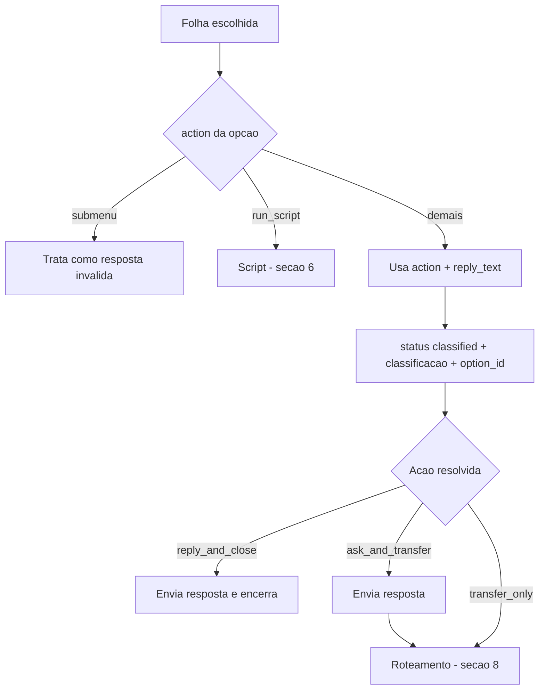

| `action` | O que faz |
|---|---|
| `reply_and_close` | envia `reply_text` e encerra com `leave_chat` — status `closed` |
| `ask_and_transfer` | envia `reply_text` e **tenta transferir**; com perguntas cadastradas na opcao, **coleta antes** (secao 6.1) |
| `transfer_only` | **tenta transferir** sem texto |
| `submenu` | abre os filhos — nao e folha |
| `run_script` | inicia o script configurado na opcao |


## 6. Scripts `run_script`

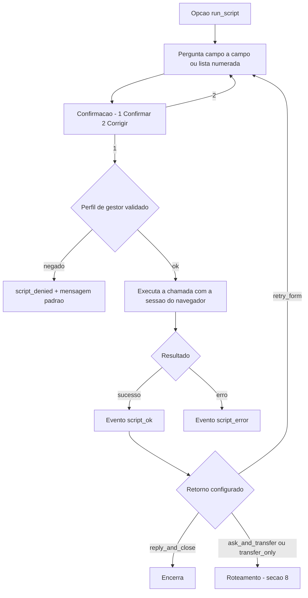

- Status durante o script: `awaiting_script_answer` -> `awaiting_script_confirm` -> `awaiting_script_run`.
- Os campos aceitam `text`, `int` e `choice` (escolha pelo numero da lista).
- `tick_timeouts` retoma script que ficou preso em `awaiting_script_run` (orcamento `BUDGET_SEC`).
- O perfil do operador e checado em `resourcemanagement` (`resource_profile.py`); sem permissao, o bot responde a mensagem padrao e registra o motivo.

### 6.1 Perguntas antes de transferir (`ask_and_transfer` com perguntas)

A folha `ask_and_transfer` pode ter perguntas cadastradas no painel (aba Menus, 1 a 20 por opcao,
tabela `menu_option_questions`). **Sem perguntas o comportamento e o antigo.**

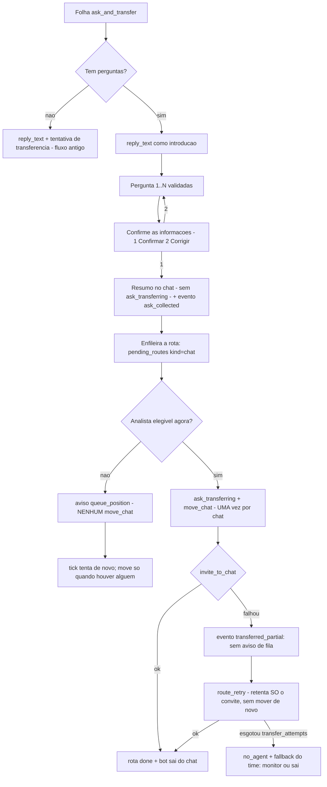

- Tipos de pergunta: `texto`, `numero` e `escolha` (numerada) - a **mesma validacao** dos scripts.
- Estado no banco: `chats.ask_option_id` marca a coleta e `script_field_index`/`script_answers`
  guardam o progresso e as respostas (JSON `q1..qN`). Nada fica em memoria.
- **Ordem das mensagens:** o resumo (`ask_received`) sai sem `ask_transferring`. Com analista elegivel
  o bot manda `ask_transferring` e entrega; sem analista, quem fala e o aviso `queue_position` - assim
  o tecnico nunca ve "estou transferindo/transferido" seguido de "voce e o Nº 1 da fila".
- **`move_chat` uma vez por chat:** a marca fica em `chats.moved_at` (por isso o chat nao e arrastado
  a cada retentativa). Se o `invite_to_chat` for recusado depois do move, a rota registra
  `transferred_partial` e as tentativas seguintes apenas convidam.
- **Restart/kill:** no boot o bot procura primeiro a resposta pendente (`replay_pending_reply`, evento
  `reply_replayed`); sem resposta nova, o `_resume_ask` reenvia a pergunta (ou a confirmacao) atual
  enquanto ela estiver dentro do `reply_timeout_sec`; passado o prazo de silencio, o timeout fecha o
  chat em `closed_timeout`.
- A transferencia passa pela fila (`pending_routes`), entao **sobrevive ao kill**; com a fila ligada ela
  espera por um analista elegivel sem limite de tempo, e com a fila desligada respeita
  `transfer_attempts`/`transfer_retry_interval_sec`; ao esgotar, aplica o fallback do time. A espera sem
  limite vale para "**sem analista**": se o chat **ja foi movido** e o convite esta falhando, as
  tentativas contam normalmente (senao o chat ficaria pulando para sempre).
- Textos configuraveis na aba Templates: `ask_received` (cabecalho do resumo) e `ask_transferring`
  (enviado apenas quando ha entrega).
- Eventos novos: `ask_collected` (respostas no `detail`), `route_retry` (nova tentativa da rota de chat)
  e `transferred_partial` (move feito, convite recusado pelo TOA).
- No painel as respostas aparecem na aba **Chats** (coluna "Respostas", com o texto das perguntas).


## 7. Formulario de validacao: deteccao e roteamento

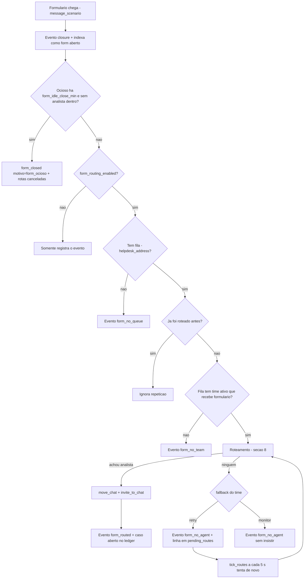

- O bot **nao entra** no formulario, **nao envia mensagem** e **nao encerra**: ele nao e interativo.
  Quem conversa com o tecnico e o **chat dele** (abertura form-aware, secao 4.1) — nunca o formulario.
- Intervalo e limite das novas tentativas: `form_route_retry_interval_sec` e `form_route_attempts`.
- **Leitura viva antes de cada entrega:** o bot le as mensagens do formulario (`get_chat_messages`, so leitura) antes de tentar `move_chat`. Com isso ele (a) **nunca** entrega formulario ja encerrado (`form_skip_past`) e (b) descobre o **AUTOR** das mensagens, que e a identidade do caso quando o payload vem sem o address do tecnico.
- **Ja com analista:** se as mensagens mostram um analista do time dentro (`user_joined`), o bot **adota** esse dono (`form_adopted`) em vez de mover de novo — o TOA recusaria o `move_chat` (`e=10`). No teto de recusas (`form_move_max_fail`) a rota para com `form_move_refused`.
- Uma fila **desabilitada para chat** continua roteando formulario: o que vale e `form_routing_enabled` (global) e **Formulario = recebe** (por time).
- **Janela de vida:** a varredura revalida um formulario por tick e, sem mensagem nova por `form_idle_offer_min` (30 min) e sem analista do time dentro, ele **para de ser oferecido** (`form_aware_skip … ociosos=`); no fechamento valem duas reguas — `form_idle_close_min` (120 min, `motivo=form_ocioso`) e `form_idle_owner_close_min` (240 min, `motivo=form_ocioso_analista`) quando **ha analista do time dentro** (o TOA nao mostra a saida dele). Sem isso um formulario morto ocupava a fila e a vaga do analista ate o TTL de 12 h.
- **Indice enxuto:** a poda roda tambem na varredura e descarta o formulario cujo caso no ledger ja foi encerrado de verdade (`form_done`/`chat_removed` → `form_forget motivo=caso_encerrado`). Caso expirado por TTL/`stale_boot` nao descarta (pode estar aberto no TOA).
- **Palpite so sem responsavel:** candidato com caso aberto no ledger (ou com analista do time dentro) nao entra no palpite por fila; se nao houver nenhum livre, a abertura nao acontece (`em_atendimento:<n>`).
- O mesmo formulario nunca e roteado duas vezes: a marca fica em `pending_routes`, inclusive apos restart. Quando o formulario encerra, as rotas `waiting` dele sao encerradas (`form_route_cancelled`) — antes ficavam tentando `move_chat` para sempre.

## 8. Roteamento: quem recebe a demanda

O roteamento e **um so** para chat e formulario, com a mesma fonte de carga. A unidade de carga e o **CASO**, e um caso e **um solicitante distinto**: formulario + chat do **mesmo tecnico** contam como **um caso**.

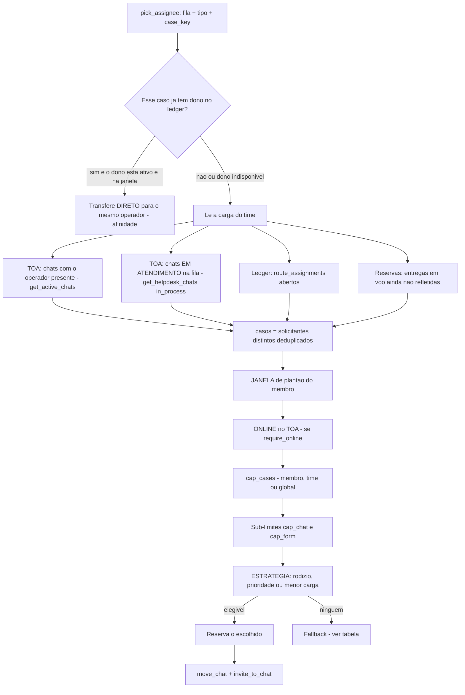

### 8.1 De onde vem a carga

| Fonte | Detalhe | Ajuste |
|---|---|---|
| Chats do operador no TOA | `get_active_chats` - participante com `present` | `route_capacity_source` = active |
| Chats em atendimento na fila | `get_helpdesk_chats` com `chat_type = in_process` - ja traz participantes | `route_capacity_source` = helpdesk |
| Ledger do bot | `route_assignments` abertos: o que o bot entregou e ainda nao fechou | `route_assign_ttl_sec` |
| Reservas | entregas em voo, contadas antes do TOA refletir | `route_reserve_ttl_sec` |

- Padrao `route_capacity_source = both`: soma as duas fontes do TOA, deduplicando por `chat_id`.
- **Se o TOA nao responder**, a carga **nao zera**: vale o ledger e as reservas, e o evento registra `carga_toa=indisponivel`.

### 8.2 Ordem exata da decisao

1. **Afinidade** - se o caso ja tem dono e ele esta **ativo + na janela**, entrega direto para ele, mesmo com o cap cheio. Online so barra se `affinity_require_online` = true.
   - A chave do caso de um formulario sai do `address` do payload **ou do AUTOR das mensagens** dele; `db.case_owner` procura o dialeto atual (`a:u:...`) e o legado (`u:...`), entao um caso aberto antes da normalizacao das chaves nao fica invisivel para a afinidade.
   - Formulario **ja com um analista do time** dentro (mensagem de `user_joined`): o bot **adota** esse dono (`form_adopted`, sem repetir o `move_chat` que o TOA recusaria com `e=10`) e a carga do analista passa a contar a verdade.
2. **Membros ativos do time**, na ordem do campo Ordem da aba Times.
3. **Janela de plantao** do membro - vazio ou inicio igual ao fim = 24 h; madrugada 22:00-06:00 atravessa a meia-noite.
4. **Online no TOA** - apenas se `require_online` (membro, time ou global).
5. **Cap de casos** - `cap_cases` do membro, senao do time, senao `max_cases_per_agent` (padrao 4).
6. **Sub-limites** por tipo - `cap_chat` e `cap_form` contam so o proprio tipo.
7. **Estrategia** - escolhe entre os elegiveis.
8. **Reserva** o escolhido e emite `move_chat` (**unico por chat**, marca em `chats.moved_at`) + `invite_to_chat`.

### 8.3 Estrategias

| Estrategia | Regra |
|---|---|
| `round_robin` | proximo depois do ultimo escolhido - comportamento historico |
| `priority` | maior `weight` vence; empate pelo rodizio; titular no cap cai para o proximo |
| `least_load` | menor numero de casos; empate por peso e depois rodizio |

### 8.4 Fallback quando ninguem esta elegivel

| Tipo | Opcoes | Padrao |
|---|---|---|
| Chat | `close` - encerra e o bot sai - ou `monitor` - fica em `monitoring` | `close` |
| Formulario | `retry` - insiste em segundo plano - ou `monitor` - nao insiste | `retry` |

Com a **fila de espera** ligada (padrao), o chat aguarda **ate `queue_max_wait_sec`** e nao gasta tentativas: a espera termina quando um analista elegivel aparece, quando o tecnico sai, pelo botao **Encerrar espera** ou **no vencimento** — nos tres ultimos casos cai neste mesmo fallback (`close` encerra, `monitor` deixa em `monitoring`). Com `queue_max_wait_sec = 0` a espera volta a ser sem limite. No vencimento o bot avisa o tecnico (texto `queue_expired`; com `close` o texto de encerramento ja informa) e, no caso do **formulario**, encerra a rota (`form_no_agent`) em vez de gira-la para sempre. **Excecao:** se o `move_chat` **ja foi feito** e o `invite_to_chat` esta falhando, as tentativas contam (`transferred_partial` + `route_retry`, sem repetir o move) e, ao esgotar, cai no fallback.

**Posicao e mensagens da fila.** A fila interna e uma so (chat + formulario, ordem de entrega por `id`), mas o **numero falado** conta apenas **chats** (`db.queue_position(..., so_chat=True)`) — o tecnico nao sabe que existem formularios na frente dele. E o numero so aparece a partir de `queue_top_pos` (padrao 5): acima disso ele recebe o texto de progresso `queue_progress` ("Voce avancou na fila"), que nao expoe uma posicao alta (inflada) que soa como fila que nunca anda. Entrar na fila emite `queued` para os DOIS tipos; o formulario continua **sem receber mensagem** (so o evento).

**`move_chat` recusado pelo TOA** (`e=10` = o formulario ja esta com alguem) e contado em `pending_routes.move_fails`: no teto (`form_move_max_fail`, padrao 3) a rota e **encerrada** com o evento `form_move_refused`, sem mexer no ponteiro do rodizio. Antes disso, a cada tentativa o bot le as mensagens do formulario: se um analista do time ja entrou, ele **adota** o dono (`form_adopted`) e a rota termina como entregue. Sem isso o retry girava para sempre (32 tentativas no banco real) batendo no mesmo analista a cada minuto.

### 8.5 Ciclo de vida do caso

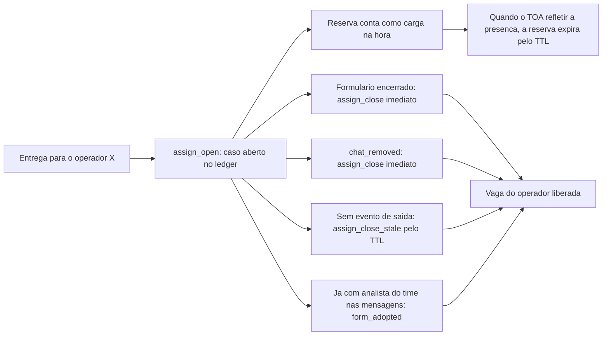

### 8.6 Como auditar uma decisao

O detalhe gravado em `bot_events` mostra o que foi contado e por que alguem foi descartado:

```text
time=T1; estrategia=round_robin; cap=4; membros=ana,bia; janela=ana:08:00-18:00;
fora_horario=bia:22:00-06:00; sem_online=—; so_chat=—; no_cap=ana;
casos=ana=4,bia=0; carga=ana=3,bia=0; tentativas=1; rr=bia-ana; last=bia
```

- `casos` = solicitantes distintos; `carga` = contagem do proprio tipo - os dois alimentam os limites.
- `so_chat` = membro que nao recebe formulario; `no_cap` = descartado pelo cap; `sem_online` e `fora_horario` explicam as demais exclusoes.

### 8.7 Fila de espera com posicao (chat e formulario)

A propria `pending_routes` e a fila: `kind` (`chat` ou `form`), `team_id`, `expires_at` e `last_position`.

| Etapa | O que acontece |
|---|---|
| Entrada | em **qualquer** opcao de transferencia (`transfer_only` e `ask_and_transfer`, com ou sem perguntas) e tambem no **formulario**: o bot tenta entregar na hora; sem ninguem elegivel, a rota fica `waiting` **sem limite de tempo** (`expires_at` nulo) |
| Aviso | o tecnico recebe o template `queue_position` (com `{pos}`) na entrada e **so quando a posicao melhora**; o formulario espera em silencio (nao existe chat para avisar) |
| Posicao | FIFO **por time**, contando chat e formulario na **mesma linha** |
| Varredura | a cada 5 s o tick tenta atribuir (FIFO por `id`, respeitando cap/janela/online); ao conseguir grava `queued_assigned` com `espera=NNs` e entrega |
| Saida | atribuido (`done`), tecnico saiu/chat removido (rota `failed` + `leave`), ou **Encerrar espera** no painel (`queue_expired` + fallback do time) |

Com a fila **ligada**, o formulario **nao gasta tentativas** (`form_route_attempts`) nem cai no
fallback: ele espera a vez e vai sendo liberado conforme a carga dos analistas diminui. Tentativas e
fallback do formulario valem com a fila **desligada**.

- `queue_wait_enabled=false` devolve o comportamento antigo: N tentativas (`transfer_attempts`) e depois fallback.
- A fila vive no banco: kill/restart nao perde posicao nem o aviso ja enviado (`last_position`).
- `queue_max_wait_sec` ficou como legado: a espera do chat nao vence sozinha, so pelo botao.
- Na aba **Roteamento** o card **Fila de espera (agora)** mostra posicao, tempo de espera, tentativas e o vencimento ("sem limite"); **Encerrar espera** vence a espera na hora e deixa o motor aplicar o fallback.
- Quando a rota do chat e encerrada por outro motivo (timeout, tecnico saiu, chat removido), a linha em `pending_routes` e fechada junto, para o tick nao insistir num chat que nao existe mais.

### 8.8 Entrega robusta (FASE A)

A entrega ganhou registro unico e travas no banco (antes a protecao era so `chats.moved_at`, escrito
depois do ACK, e um `route_seen` sem atomicidade).

| Campo (`pending_routes`) | Papel |
|---|---|
| `invite_target` | alvo escolhido, **imutavel** nas retentativas (nao troca de analista no meio) |
| `move_sent_at` | marca de que o `move_chat` ja foi enviado (chat **e** formulario) — sobrevive ao restart |
| `case_key` / `requester_addr` | identidade do caso gravada na entrega (o chat nao perde mais o `case_key`) |
| `claimed_by` / `claimed_at` / `claim_expires_at` | posse (lease) da entrega: uma execucao por vez |
| indice unico `pending_routes_active` | **uma** operacao ativa por `(kind, chat_id)`, garantida no banco |

- `delivery_attempts` registra cada chamada externa de entrega (`move_chat`, `invite_to_chat`,
  `leave_chat`) com alvo, `r` do TOA, resultado (`ok`/`timeout`/`error`) e latencia; o detalhe do
  evento `transferred` passou a trazer `move=`/`invite=`.
- Ledger: `route_assignments.close_reason` (`chat_removed`, `stale_boot`, `form_done`, `ttl`, `manual`)
  e varredura de boot (`_sweep_stale_cases`) que fecha o caso quando o TOA nao mostra mais o item,
  respeitando `case_stale_confirm_sec`; `resume_stale` tambem fecha.
- Eventos novos: `case_closed`, `delivery_duplicate_blocked`, `delivery_target_locked`,
  `delivery_failed_no_team`, `delivery_recovered`.
- Painel (aba Roteamento): **Entregas paradas e sem dono** (rotas `failed`/`cancelled` + chats
  `classified` sem rota, com *Reprocessar*) e **Casos abertos (ledger) e tentativas (24 h)**
  (com *Liberar*), alem do `close_reason` visivel.


## 9. Timers e saude do processo

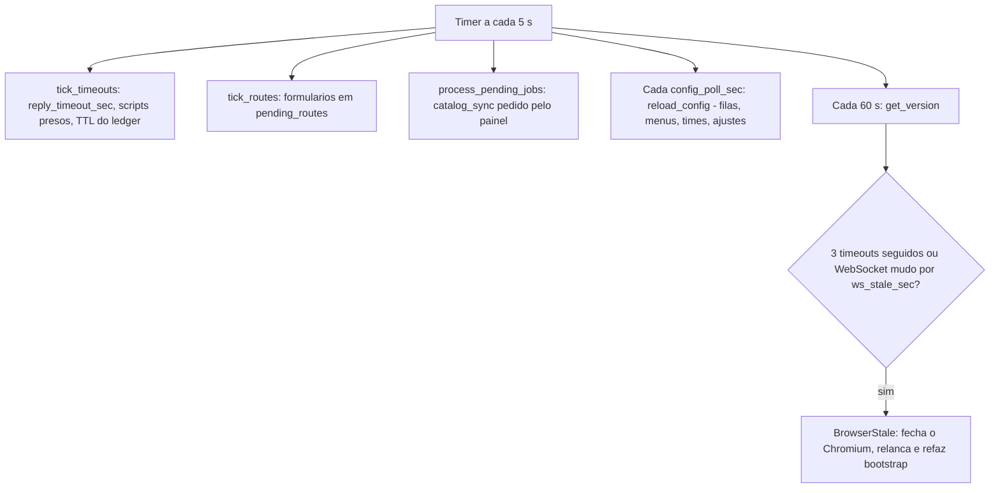

| Ajuste | Padrao | Para que serve |
|---|---|---|
| `reply_timeout_sec` | 300 | tempo de **silencio do tecnico** antes de encerrar (conta a ultima resposta em `last_reply_at`) |
| `max_invalid_retries` | 3 | respostas invalidas antes de encerrar |
| `config_poll_sec` | 15 | intervalo de recarga das configuracoes |
| `ws_stale_sec` | 180 | WebSocket mudo que dispara reciclagem |
| `route_assign_ttl_sec` | 43200 | TTL do caso orfao no ledger |
| `route_reserve_ttl_sec` | 300 | validade da reserva de carga |
| `form_move_max_fail` | 3 | recusas de `move_chat` no formulario (`e=10`) antes de encerrar a rota (`form_move_refused`) |
| `form_idle_offer_min` | 30 | minutos sem mensagem nova (e sem analista do time dentro) para o formulario **deixar de ser oferecido** na abertura |
| `form_idle_close_min` | 120 | minutos sem sinal de vida para o formulario **sair do indice** e o caso fechar (`form_closed motivo=form_ocioso`) |
| `form_idle_owner_close_min` | 240 | mesma janela, mas para formulario parado **com analista do time dentro** (`motivo=form_ocioso_analista`) — o TOA nao avisa quando ele sai |
| `queue_max_wait_sec` | 1800 | vencimento da espera do chat: ao vencer o bot avisa (`queue_expired`) e aplica o fallback do time (`0` = sem limite) |
| `queue_top_pos` | 5 | posicao a partir da qual o chat ouve o NUMERO da fila; acima disso recebe o texto de progresso (`0` = sempre fala o numero) |

## 10. Restart, resume e reciclagem

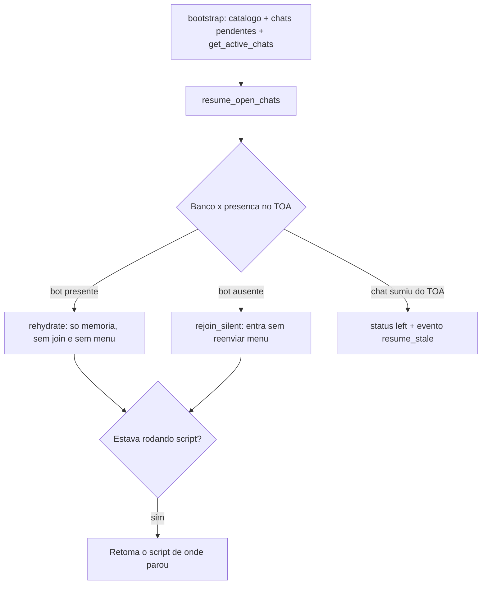

- Status retomados no restart: `joined`, `menu_sent`, `awaiting_reply`, `classified`, `monitoring`, `awaiting_script_answer`, `awaiting_script_confirm`, `awaiting_script_run`.
- O menu **nunca** e reenviado no resume: o tecnico continua do ponto em que estava.
- A fila de retry do formulario e o ledger ficam no banco, entao tambem sobrevivem ao restart.
- A coleta de perguntas (`chats.ask_option_id`) tambem: no boot o bot reenvia a pergunta ou a
  confirmacao atual (dentro do `reply_timeout_sec`) e a rota de transferencia enfileirada segue
  sendo drenada pelo tick.

## 11. Banco de dados: 28 tabelas e o papel de cada uma

### Catalogo do TOA

| Tabela | Papel |
|---|---|
| `queues` | filas (`h:...`) com nome e o liga/desliga do bot (`enabled`) |
| `queue_operators` | operadores por fila, vindos do `search_contact` ou cadastro manual |
| `transfer_targets` | destinos de transferencia — **hoje o motor nao usa** |

### Menu e atendimento

| Tabela | Papel |
|---|---|
| `menus` | menus nomeados |
| `menu_queues` | menu ligado a 1 fila |
| `menu_options` | opcoes raiz e filhas: `label`, `classification`, `action`, `reply_text`, `script_slug` (`action_if_form`/`reply_text_if_form` ficaram como **legado sem uso**) |
| `menu_option_targets` | alvos por opcao — **hoje o motor nao usa** |
| `templates` | textos: `greeting`, `menu`, `retry`, `closing`, `ask_received`, `ask_transferring`, `queue_position`, `form_pending`, `form_pending_wait`, `form_waiting` |
| `menu_option_questions` | perguntas da opcao `ask_and_transfer`, coletadas no chat antes de transferir |

### Times e roteamento

| Tabela | Papel |
|---|---|
| `teams` | times (plantao) |
| `team_members` | membros: ordem, ativo, janela `route_start`/`route_end`, `last_assigned` legado |
| `team_queues` | fila ligada a 1 time — base do roteamento de **chat e formulario** |
| `team_routing` | politica do time: estrategia, caps, online, janela, tentativas, fallback, recebe formulario, rodizio por tipo |
| `team_member_routing` | peso e caps por membro |
| `route_assignments` | **ledger dos casos**: quem atende cada solicitante, `case_key`, contato do solicitante e `closed_at` |
| `pending_routes` | **fila de espera**: retry do formulario (`kind=form`), fila do chat com posicao (`kind=chat`, `expires_at`, `last_position`) e trava anti-duplicidade |

### Estado e observabilidade

| Tabela | Papel |
|---|---|
| `chats` | estado por `chat_id`: status, classificacao, retries, timestamps, script |
| `bot_events` | log de eventos — **sem texto de conversa** |
| `bot_jobs` | pedidos do painel, hoje `catalog_sync` |
| `bot_settings` | parametros globais |
| `bot_users` | usuarios do painel (`display_name`, `operator_address`, `group_id`, `last_login_at`) |

### Painel (RBAC) — criadas na Fase 1

| Tabela | Papel |
|---|---|
| `permission_groups` | grupo de permissao do painel (`is_super` = Super Admin) |
| `group_permissions` | chaves de permissao do grupo (o catalogo de chaves fica no PHP) |
| `group_teams` / `group_queues` / `group_menus` | **escopo de dados do grupo**: times, filas e menus que ele enxerga |
| `user_teams` / `user_queues` | legado (escopo por usuario da primeira versao); a migracao copia para o grupo |

Filas visiveis = filas de `group_teams` (via `team_queues`) + `group_queues`; sem
marcacao e sem `scope.all_*` o grupo nao ve dado nenhum (negar por padrao). O motor
de atendimento **nao le** nenhuma dessas tabelas; `bot_migrate_rbac` (PHP) e
`_migrate_rbac` (Python) sao espelhos e rodam duas migracoes uma unica vez cada:
`rbac_seeded` (promove usuarios legados a Super Admin) e `rbac_scope_groups`
(copia `user_*` -> `group_*`).


## 12. Onde cada coisa se configura no painel

| Aba | O que se configura |
|---|---|
| **Dashboard** | volume de classificacoes por categoria no periodo, resumo dos eventos do formulario e **fila de espera do chat** (na fila agora, espera media e maior espera) |
| **Filas** | liga/desliga a fila para o bot e dispara a sincronizacao do catalogo |
| **Operadores** | operadores por fila, vindos do TOA ou cadastro manual |
| **Times** | time, membros, **Ordem**, **janela de plantao** e as filas do time |
| **Roteamento** | **globais** - bot ligado, formulario roteado, estrategia, fallback, caps, **fila de espera** (ligada/desligada e espera maxima) - **por time** - estrategia, caps, online, plantao, tentativas, fallback, recebe formulario - **por membro** - peso, cap chat, cap form, casos e recebe formulario |
| **Menus** | menus, opcoes, submenus, acao/texto normais, **acao/texto se formulario aberto** e scripts |
| **Templates** | textos `greeting`, `menu`, `retry`, `closing`, `ask_received`, `ask_transferring`, `queue_position` (posicao na fila de espera) e a abertura form-aware: `form_pending` (`{analista}`), `form_pending_wait` e `form_waiting` |
| **Atividade** | log de eventos com filtro por tipo e atualizacao automatica na primeira pagina |
| **Chats** | estado dos chats, sem conteudo de conversa |
| **Ajustes** | timeout de resposta, retries invalidos, poll de config e reciclagem do WebSocket |
| **Usuarios** (super-only) | contas do painel: login, senha, nome, address do TOA e grupo (o escopo herdado aparece em leitura) |
| **Grupos** (super-only) | permissoes (paginas, acoes e `scope.all_*`) **e** o escopo de dados: times, filas e menus do grupo |

## 13. Eventos registrados em bot_events

| Grupo | Eventos |
|---|---|
| Entrada e assuncao | `assumed`, `menu_sent`, `not_new`, `queue_off`, `queue_unknown`, `bot_off`, `join_failed` |
| Conversa e desfecho | `ignored_reply`, `reply_replayed`, `send_failed`, `classified`, `transferred`, `no_agent`, `closed_invalid`, `closed_timeout`, `closed_no_agent`, `left`, `resume_stale` |
| Scripts | `script_ok`, `script_error`, `script_denied` |
| Formulario de validacao | `closure`, `form_routed`, `form_no_agent`, `form_route_retry`, `form_no_team`, `form_no_queue`, `form_adopted` (ja estava com um analista do time), `form_move_refused` (`move_chat` recusado no teto), `form_skip_past` (formulario encerrado nao entra na fila) |
| Abertura form-aware | `case_linked`, `case_link_unconfirmed` (vinculo por palpite de fila, sem identidade), `form_aware_greeting`, `form_aware_choice`, `form_aware_wait`, `form_aware_skip`, `case_sibling_delivered` |
| Indice do formulario | `form_indexed`, `form_not_open`, `form_dropped`, `form_ignored_payload`, `form_queue_left`, `form_forget`, `form_state` (pendente/em atendimento/passado), `form_closed`, `form_route_cancelled` |
| Resposta ignorada | `message_ignored` (mensagem do tecnico em status que o bot nao trata; antes era silencioso) |
| Identidade do caso | `case_key_divergente` (a chave da rota foi ignorada: a identidade do payload manda) |
| Catalogo | `catalog_synced`, `sync_error` |
| Perguntas antes de transferir | `ask_collected`, `route_retry` |
| Fila de espera | `queued`, `queue_position`, `queued_assigned`, `queue_expired` |

## 14. Status possiveis do chat

| Status | Significado |
|---|---|
| `detected` | chat identificado, ainda sem presenca confirmada |
| `joined` | bot entrou no chat |
| `menu_sent` | menu enviado |
| `awaiting_reply` | esperando o digito, com timeout |
| `awaiting_form_choice` | abertura form-aware: esperando 1 (falar sobre o formulario) ou 2 (abrir o menu) |
| `awaiting_script_answer` | script: preenchendo campo |
| `awaiting_script_confirm` | script: confirmando os dados |
| `awaiting_script_run` | script: execucao em andamento |
| `classified` | folha aplicada, com classificacao gravada |
| `monitoring` | bot fica no chat sem menu, aguardando desfecho |
| `closed` | encerrado pelo bot apos transferir ou responder |
| `closed_invalid` | encerrado por respostas invalidas |
| `closed_timeout` | encerrado por silencio real do tecnico (resposta perdida no restart e recuperada em `reply_replayed`) |
| `closed_no_agent` | encerrado por nao haver analista elegivel e fallback close |
| `closed_originator_left` | o tecnico saiu |
| `left` | chat removido ou bot saiu |

Quem esta na fila de espera continua em `classified` ate ser atribuido (`closed`), o tecnico sair (`closed_originator_left`) ou a espera ser encerrada no painel (fallback do time: `closed_no_agent` ou `monitoring`). O vencer por tempo nao acontece mais sozinho.

## 15. O que ainda nao existe

| Item | Situacao |
|---|---|
| **Fila de espera com posicao** | **feita Fase 2** - vive na `pending_routes` (nao numa `route_queue` a parte): posicao FIFO por time, aviso no chat e silencio no formulario |
| **Abertura form-aware** | **feita**: ao assumir, se o tecnico tem formulario aberto, o bot oferece 1) falar sobre o formulario / 2) abrir o menu (secao 4.1); o chat espera o analista do formulario ou entra na fila, e chat + formulario do mesmo tecnico sao **um caso so** |
| **Painel da fila de espera** | **feito Fase 2** na aba Roteamento: posicao, tempo de espera, tentativas, vencimento e "Encerrar espera". "Vagas do time" nao entram: dependem da presenca ao vivo do TOA, que o painel nao enxerga |
| **Metricas de espera** | **feitas Fase 2**: card "Fila de espera do chat" no Dashboard (na fila agora, espera media e maior espera do periodo) |
| `action_if_form` / `reply_text_if_form` do menu | **legado sem uso**: o painel grava vazio e o motor ignora (removido junto com `has_open_validation_form`); a abertura form-aware ficou no vinculo do caso (secao 4.1) |
| `transfer_targets` e `menu_option_targets` | **codigo morto**: o motor sempre roteia pelo time; decidir entre implementar ou remover da UI |
| `CHAT_TYPE_ROUTING` do TOA | existe um modo de roteamento nativo no TOA - vale investigar como bonus |
| Escopo do `get_active_chats` | validar em producao: o campo `carga_toa=` no detalhe mostra quantos chats o bot enxergou |

## 16. Como rodar e testar

```bash
# Bot - completa o login na primeira vez e guarda a sessao em .chrome-profile/
.venv\Scripts\python run.py

# Testes Python - um arquivo por vez
python tests/test_case_cap.py
python tests/test_routing.py
python tests/test_form_route.py
python tests/test_form_open.py
python tests/test_form_aware.py
python tests/test_ask_flow.py
python tests/test_queue.py
python tests/test_reply_lost.py

# Suites PHP
php tests/test_routing_schema.php
php tests/test_submenu_schema.php
php tests/test_rbac_schema.php
php tests/test_permissions.php
php tests/test_queue_schema.php
php tests/test_questions_schema.php
php tests/test_delivery_schema.php
php tests/test_form_aware_schema.php
php tests/test_panel_render.php
```

---

**Resumo em uma frase:** o bot assume o chat da fila habilitada, **abre form-aware quando o tecnico ja tem um formulario de validacao em andamento (1 falar sobre ele / 2 menu, com chat e formulario como um caso so)**, oferece o menu, classifica a folha escolhida e entao decide quem recebe - contando **casos por solicitante** no TOA, no ledger e nas entregas em voo - com **afinidade** para o formulario do mesmo tecnico, **fila de espera com posicao e sem limite de tempo** no chat (o tecnico so sai quando um analista aparece, ele mesmo sai ou alguem usa *Encerrar espera*), timeout medido por **silencio real do tecnico** com recuperacao da resposta que chegou com o bot fora, e retry assincrono para o formulario, que nunca entra na conversa nem e encerrado pelo bot.

