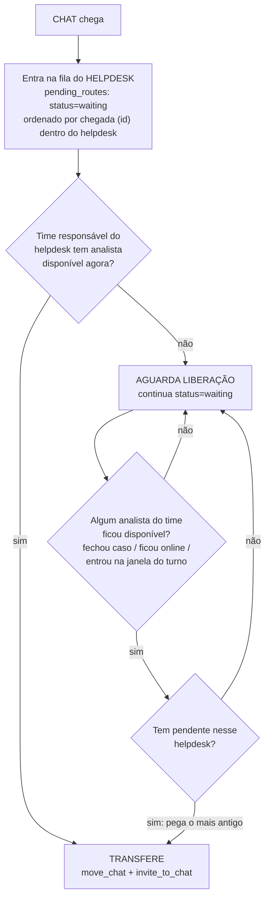

# Plano de correção — fila "esquecida" até o próximo reinício do bot

Diagnóstico de produção em **2026-11-10/11** (base `chat_bot_toa`, caso
`chat_id=17778818`, time **EMPRESARIAL PILOTO SPI**, fila `h:27@clarosa`). Este
documento é a **proposta técnica para análise e aprovação** — nenhuma linha de
código foi alterada ainda.

> **Status (2026-11-11): implementado** no repositório — Mudança 1 (sem
> orçamento compartilhado entre helpdesks, teto só na entrega), Mudança 2
> (gatilho de disponibilidade do analista), reforço de boot
> (`wake_all_routes`) e alerta de leitura degradada. Suíte de testes
> atualizada e verde (`tests/test_routing.py`, `tests/test_queue.py`,
> `tests/test_load.py`). Falta o **deploy em produção** (ver seção abaixo).

## Causa raiz (diagnóstico, sem mudança nesta seção)

- **Sintoma:** um chat classificado ficou **5h29min** parado em
  `pending_routes.waiting` esperando analista, e só foi roteado 13 segundos
  depois de um reinício/reciclagem do processo do bot.
- **Causa 1 — orçamento compartilhado entre helpdesks:**
  [`db.due_routes`](../python/db.py#L1747) mistura **todas as filas
  (helpdesks)** numa lista só e corta em **5 rotas por tick**, escolhidas por
  rodízio recalculado do zero a cada tick (sem memória). Com ≥13 helpdesks
  simultaneamente sem analista elegível (madrugada), os mesmos helpdesks
  "mais antigos" vencem o orçamento tick após tick, e um helpdesk mais novo
  pode nunca ser avaliado — ficando sem nova tentativa por horas, mesmo
  quando o time dele já tem vaga livre (confirmado: `route_assignments` mostra
  1 vaga real liberada às 06:37, **1h40 antes** da entrega, não aproveitada).
- **Causa 2 — a fila só "acorda" por dentro, de forma frágil:** a única coisa
  que reavalia uma rota fora do tick normal é `wake_team_routes`, chamada
  **somente** quando o bot detecta internamente que um caso fechou
  (`_close_case`). Essa detecção depende de leitura bem-sucedida do TOA por
  fila (`_fecha_chats_ausentes`); se a leitura falhar de forma persistente
  para um helpdesk, a liberação de vaga nunca é percebida, e só o reinício do
  processo (`bootstrap`/`resume_open_chats`) reconcilia contra o TOA de
  verdade.

---

## Desenho simplificado (substitui a Revisão 1 deste documento)

Regra de negócio, confirmada pelo usuário:

1. **A fila é por helpdesk** (`pending_routes.queue_address`), ordenada do
   **mais velho para o mais novo** — FIFO por helpdesk, não uma fila global
   misturada entre helpdesks diferentes.
2. **Cada helpdesk tem exatamente um time responsável**
   (`team_queues`, já é 1:1 — `UNIQUE KEY (queue_address)`). O roteamento de
   um helpdesk depende **só** da disponibilidade dos analistas do time dele.

Fluxo:



Isso já é quase o que o banco faz hoje — **o ajuste é remover o que atrapalha
essa regra simples**, não criar tabela nova:

### Mudança 1 — avaliar TODO helpdesk a cada tick (tirar o orçamento compartilhado)

Hoje `due_routes` olha só 5 rotas por tick, somando todos os helpdesks.
Verificar "o time tem vaga?" é **barato** (usa `analyst_load`, já em cache —
não liga pro TOA); o que precisa de limite é só a **entrega de fato**
(`move_chat`/`invite_to_chat`, chamada real ao TOA), para não estourar em
rajada quando muitos helpdesks liberam ao mesmo tempo.

**Arquivo:** `python/db.py` (`due_routes`) + `python/engine.py` (`tick_routes`).

```python
# db.py — devolve 1 rota (a mais antiga) por HELPDESK com pendencia devida,
# para TODOS os helpdesks — sem cortar em 5 global. O helpdesk e a unidade
# de fila (1 helpdesk = 1 time responsavel, team_queues e 1:1).
def due_routes(conn, scan_limit: int = 2000) -> dict[str, list[dict]]:
    linhas: dict[str, list[dict]] = {}
    for kind in ("chat", "form"):
        vencidas = conn.execute(
            """SELECT * FROM pending_routes
               WHERE status = 'waiting' AND kind = ?
                 AND (next_try_at IS NULL OR datetime(next_try_at) <= datetime('now'))
               ORDER BY queue_address, priority DESC, id
               LIMIT ?""",
            (kind, max(1, int(scan_limit))),
        ).fetchall()
        linhas[kind] = _mais_antigo_por_helpdesk(vencidas)  # 1 por queue_address, todos
    return linhas
```

Em `tick_routes`, limitar **só as entregas efetivas** por tick (ex.: 20),
deixando o resto para o próximo tick (5s depois — sem impacto prático):

```python
ENTREGAS_POR_TICK = 20
entregas = 0
for row in fila:
    ...
    if entregas >= ENTREGAS_POR_TICK:
        break  # resto fica para o proximo tick, 5s depois — nao e descartado
    ok, detail = await self._deliver_chat(...)
    if ok:
        entregas += 1
```

**Risco:** baixo — remove um corte artificial; não muda a regra de negócio
(ainda é 1 por helpdesk por rodada, mais antigo primeiro).

### Mudança 2 — gatilho de liberação do analista (o lado "ANALISTA LIBEROU?")

`snapshot_load` ([engine.py:3215](../python/engine.py#L3215)) já lê, a cada
30s, **direto do TOA**: quantos casos físicos cada analista tem
(`casos_toa`), se está online, e já conhece a janela do turno — é o sensor
de disponibilidade mais confiável que existe hoje (não depende da detecção
frágil de fechamento de caso). Hoje esse dado só alimenta a tabela de carga;
falta ligá-lo ao "avisa a fila".

**Arquivo:** `python/engine.py`, dentro do loop de `snapshot_load`
(~linha 3301), onde `casos`/`online`/janela já são calculados por analista:

```python
elegivel_antes = self._elegivel_cache.get(addr)
elegivel_agora = (
    _in_route_window(m, agora) and
    (not settings_time.get("require_online", True) or _member_login(addr) in online) and
    len(casos) < cap_do_time
)
if elegivel_antes is False and elegivel_agora:
    # Analista acabou de ficar disponivel: acorda so o(s) helpdesk(s) do
    # time dele (nao acorda os outros times travados ao mesmo tempo).
    db.wake_team_routes(self.conn, tid)
self._elegivel_cache[addr] = elegivel_agora
```

- Dispara **só na transição** (falso→verdadeiro), não a cada leitura — por
  isso não recria a disputa de orçamento entre helpdesks (só quem realmente
  mudou de estado acorda).
- Sem chamada nova ao TOA: reaproveita dado já lido.
- `wake_team_routes` já existe e já zera o backoff do helpdesk — o próximo
  `tick_routes` (em até 5s) entrega para o mais antigo pendente daquele
  helpdesk, puxado pela Mudança 1.

**Risco:** baixo — é aditivo; na pior hipótese gera um `wake` a mais (barato,
sem custo de TOA).

### Blindagem a reinício e a corrida de confirmação

- **Entrega em si já é segura a reinício:** `claim_delivery`
  ([db.py:1898](../python/db.py#L1898)) usa lease de 300s — se o processo cai
  no meio da entrega, o claim expira sozinho e outra execução (ou o próprio
  boot) retoma sem duplicar, porque antes de repetir a chamada ao TOA a rota
  é reconferida contra `route_assignments`/estado do chat. **Não precisa
  mudar.**
- **Reforço no boot:** `bootstrap` ([engine.py:4292](../python/engine.py#L4292))
  passa a chamar `wake_team_routes` para **todos os times ativos** uma vez,
  logo depois do `resume_open_chats` — garante que, assim que o processo
  volta, toda fila pendente é reavaliada imediatamente, sem esperar o
  primeiro `snapshot_load` natural (até 30s depois).
- **Ponto cego que continua existindo e não tem solução estrutural simples:**
  se a leitura do TOA falhar de forma persistente para um helpdesk
  específico, nem a detecção de fechamento de caso nem a Mudança 2 enxergam a
  liberação (ambas dependem do mesmo dado). Proposta mínima: emitir
  `queue_read_degraded` quando `toa_ok` ficar falso por mais que um teto (ex.:
  5 min) para um helpdesk — só visibilidade, não resolve sozinho, mas tira o
  silêncio de hoje.

---

## O que sai do plano anterior (revisão 1)

- **Removido:** watchdog de idade por rota com `bot_settings` novos
  (`route_starvation_sec`/`overflow`) e cursor persistido de rodízio entre
  times. Ficam desnecessários com o desenho simplificado: sem orçamento
  compartilhado entre helpdesks (Mudança 1) e com o gatilho de liberação
  (Mudança 2), não há mais "fila que nunca é vista".
- **Mantido, reduzido a 1 item de observabilidade:** alerta de leitura
  degradada (`queue_read_degraded`), como rede de segurança final para o
  único ponto cego que resta.

---

## Testes (obrigatórios antes do deploy)

```powershell
Get-ChildItem tests\test_*.py | % { python $_.FullName }
```

Testes novos:
- `tests/test_queue.py` — **13+ helpdesks** com pendência simultânea (o
  cenário real do incidente): confirmar que `due_routes` devolve 1 rota de
  **cada** helpdesk na mesma passada (não só os 5 "mais antigos" globais).
- `tests/test_queue.py` — mais de 20 entregas simultaneamente possíveis num
  tick: confirmar que só `ENTREGAS_POR_TICK` são de fato chamadas (`move_chat`/
  `invite_to_chat`), e o resto segue `waiting` para o próximo tick (sem
  perder posição/FIFO do helpdesk).
- `tests/test_load.py` — transição de indisponível→disponível em
  `snapshot_load` chama `wake_team_routes` **uma única vez** (não repete a
  cada leitura enquanto ele continuar disponível); transição
  disponível→indisponível não chama.
- `tests/test_resume.py` — `bootstrap` chama `wake_team_routes` para todos os
  times ativos uma vez no boot.
- `tests/test_load.py` — `toa_ok=False` persistente emite
  `queue_read_degraded` uma única vez.

## Documentação

- `docs/desenho-bot.md` — atualizar a seção de `due_routes` (sem orçamento
  global, 1 por helpdesk) e a seção 10 (restart) com o `wake` de boot;
  incluir `queue_read_degraded` na lista de eventos.

## Deploy em produção

1. **Backup:** `mysqldump chat_bot_toa > chat_bot_toa_<data>.sql`.
2. Aplicar as Mudanças 1 e 2 juntas (são complementares — a 1 faz o "puxão"
   do lado da fila, a 2 faz o "empurrão" do lado do analista).
3. Subir o bot; observar `bot_events` (`wake` implícito via `queued`/
   `transferred` mais frequentes, e `queue_read_degraded` se aparecer) nas
   primeiras horas; conferir que nenhum `pending_routes.waiting` fica sem
   `next_try_at` atualizado por mais que ~1 min com o time correspondente
   tendo vaga livre em `analyst_load`.

## Rollback

- `git revert` dos commits — nenhuma mudança de schema, só de lógica de
  seleção/gatilho.

## Impacto no painel (outro repositório)

Um evento novo em `bot_events.reason`: `queue_read_degraded`. Não muda schema
de tabela nem contrato de endpoint existente — é dado novo que o painel pode
querer exibir como alerta de "leitura da fila degradada". **Ajuste manual
necessário no outro repositório, se decidirem exibir esse evento** — não é
automático.

## Arquivos afetados

| Arquivo | Mudança |
|---|---|
| `python/db.py` | Mudança 1 (`due_routes` sem orçamento global, 1 por helpdesk) |
| `python/engine.py` | Mudança 1 (`tick_routes` com teto só nas entregas), Mudança 2 (`snapshot_load` dispara `wake_team_routes` na transição), boot chama `wake_team_routes` geral, `queue_read_degraded` |
| `tests/*` | testes novos listados acima |
| `docs/desenho-bot.md` | atualização do fluxo/eventos |
